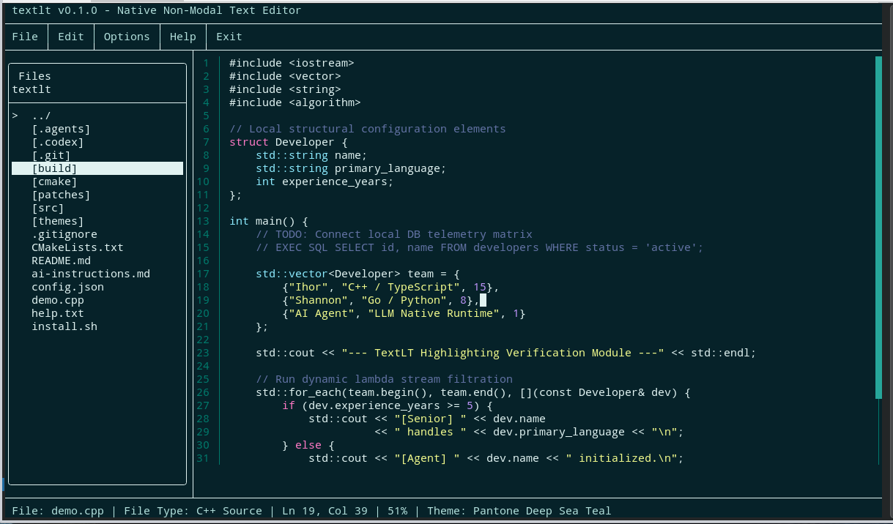

# textlt

[Website & installation guide](https://ihor-liutak2.github.io/textlt/)

`textlt` is a lightweight, blazing-fast, and highly customizable **Terminal User Interface (TUI)** text editor built from scratch in C++. Designed for modern developers who love the efficiency of the command line but prefer intuitive, modeless text editing over complex Vim/Emacs modal constraints.

Optimized to run perfectly in native Linux environments (**MX Linux**, **Ubuntu**, **Debian**) as well as **WSL (Windows Subsystem for Linux)**.

---

## Interface Preview



---

## Key Features

- **Intuitive Modeless Editing:** No "command" or "insert" modes. Just open, click, and start typing, exactly like modern GUI text editors.
- **Advanced Polyglot Syntax Highlighting:** Powered by an ultra-fast state-machine engine that pre-scans syntax layout matrices up to the active viewport boundaries:
  - **Languages:** `C++`, `C`, `PHP` (with native WordPress multi-language support), `Python`, `Ruby` (inc. `Gemfile`), `Java`, `JavaScript`, `TypeScript`, `HTML`, `XML`, `CSS`, `SQL`, `GraphQL`.
  - **Configurations:** `YAML`, `JSON`, `Dockerfile`, `docker-compose.yml`, `.ini`, `.conf`, and `.env` profiles.
- **Embedded Syntax Engine (Heredoc/Nowdoc):** Seamlessly shifts lexical token states inside PHP code streams when encountering `<<<HTML`, `<<<CSS`, or `<<<JS` blocks, matching enterprise IDE behavior.
- **Full Interactive Mouse Integration:**
  - Fluid drag-selection tracking mapped directly onto character coordinate structures.
  - `Ctrl+Click` extends text selection inside the editor without triggering the terminal's native `Shift+Click` screen selection.
  - Smooth terminal scroll-wheel navigation.
  - Single-click cursor repositioning and side-panel file manager navigation.
- **Smart Code Commenting:** Context-aware line/block comment toggling via `Ctrl + /` that dynamically inserts language-specific prefixes (`//`, `#`, `--`) aligned cleanly before the first non-whitespace character.
- **Native Viewport Scroller & Scrollbar:** Custom right-aligned vertical TUI Scrollbar indicating precise location markers. Viewport bounds are dynamically calculated, reserving space for status indicators and input panel obstructions.
- **Split Find & Replace Panels:** Dedicated bottom overlay UI regions for real-time text matching (`Ctrl+F`) and variable replacement (`Ctrl+R`) with color-blended highlighting.
- **Modern Layout Foundations:** Soft Tabs framework supporting configurable space injections (`2` or `4`), dynamic line jumping (`Ctrl+G`), and transaction-safe atomic Undo/Redo historical snapshots.

---

## Tech Stack

- **Core Engine:** Modern C++17 (Object-Oriented, clean module subsystem split)
- **UI Architecture:** [FTXUI](https://github.com/ArthurSonzogni/FTXUI) (Functional Terminal User Interface framework)
- **Build Core:** CMake & Bash Deployment Automations

---

## Docker

The image builds TextLT from source with CMake. Both stages use Ubuntu 26.04.
It includes the editor, themes, text processors, TextLT and LocalSend Connect
providers, Telegram Bot API support, the existing AI integrations, and the
Piper runtime and local TTS server. Download a voice model when you first need
one.

### Build locally or from GitHub

From a local checkout, the build helper reads the version from `CMakeLists.txt`,
tags the image `textlt:vX.Y.Z`, and uses your Bash or WSL user and group IDs.
The image runs as that non-root user and creates Linux workspace files under
your UID/GID.

```bash
./docs/docker/build
image="textlt:$(./scripts/textlt-docker-version.sh)"
```

To build from a GitHub release source, the same version is used for the Git
ref, build argument, and image tag:

```bash
repo=https://github.com/ihor-liutak2/textlt.git
tag="$(./scripts/textlt-docker-version.sh)"
docker buildx build --load --build-arg "TEXTLT_VERSION=$tag" \
  --build-arg TEXTLT_UID="$(id -u)" --build-arg TEXTLT_GID="$(id -g)" \
  -t "textlt:$tag" "$repo#$tag"
```

The version helper is also used by the Docker launcher and Compose wrapper.
Builds of the same version replace the local tag, so rebuilding does not
require removing an old image first.

### Launch the editor

From the checkout, run the Compose service from Bash. For a WSL home directory,
enable Docker Desktop's WSL integration for that distribution and run the
command in that distro.

```bash
./docs/docker/compose run --rm textlt
```

TextLT opens your Bash home directory at `/work` and keeps the terminal
interactive. Settings, credentials you save in the app, voice downloads and
Connect identity live in the separate `textlt-state` volume at `/state`.
Use `TEXTLT_STATE_VOLUME` to choose another volume. Use a new volume when
switching to an image built for a different UID/GID.

Override the workspace with an existing directory. In WSL, the Windows profile
can be selected through its `/mnt/c/Users/…` path.

```bash
TEXTLT_WORKSPACE="/path/to/project" ./docs/docker/compose run --rm textlt
TEXTLT_WORKSPACE="/mnt/c/Users/Your Name" ./docs/docker/compose run --rm textlt
```

If you use the Windows Docker CLI from WSL, give it the Windows path and pass
the override through `WSLENV`.

```bash
TEXTLT_WORKSPACE="C:/Users/Your Name" \
  TEXTLT_DOCKER=docker.exe \
  WSLENV="${WSLENV:+$WSLENV:}TEXTLT_WORKSPACE:TEXTLT_DOCKER" \
  ./docs/docker/compose run --rm textlt
```

For an image pulled from GHCR, launch it without Compose using the matching
version tag. From a checkout, resolve the tag and pull it as follows. To open a
file directly, append its path under `/work` to the command. Images published
by the workflow use UID/GID `1000:1000`. Build locally with the IDs above if
your Linux user has different IDs.

```bash
image="ghcr.io/ihor-liutak2/textlt:$(./scripts/textlt-docker-version.sh)"
docker pull "$image"
docker run --rm -it \
  --mount "type=bind,src=${TEXTLT_WORKSPACE:-$HOME},dst=/work" \
  --mount "type=volume,src=${TEXTLT_STATE_VOLUME:-textlt-state},dst=/state" \
  "$image"
```

### Terminal and clipboard

The image uses `LANG=C.UTF-8`. The launcher starts TextLT in `/work` with
an interactive TTY, forwards the terminal type and color hint, and uses the
same workspace and state settings as Compose.

```bash
./docs/docker/run
./docs/docker/run "/work/Український документ.md"
```

On a local Linux desktop, the launcher can give TextLT’s ClipboardController
access to the host clipboard. Set `TEXTLT_CLIPBOARD` explicitly to choose the
display protocol. Wayland uses `wl-copy` and `wl-paste` through the host’s
Wayland socket. X11 uses `xclip` through its local display socket with the
host’s Xauthority file when available. Run as a matching UID and use a local
Docker daemon that can mount those sockets. Set `TEXTLT_CLIPBOARD=none` to
launch without a desktop clipboard mount.

```bash
TEXTLT_CLIPBOARD=wayland ./docs/docker/run
TEXTLT_CLIPBOARD=x11 ./docs/docker/run
```

On Windows Terminal, use terminal clipboard mode. Copy selected text with
TextLT’s Copy command. Windows Terminal receives it through OSC 52 when its
**Allow apps to write to the clipboard** setting is enabled. For host-to-editor
paste, use the Windows Terminal paste action, typically **Ctrl+Shift+V**, and
confirm the multiline paste prompt if shown. Windows Terminal handles the
clipboard read and sends the text to TextLT. The terminal path does not require
a WSLg display socket in the container.

```bash
TEXTLT_CLIPBOARD=terminal ./docs/docker/run
```

With the Windows Docker CLI and a Windows profile workspace, use the following
from Bash in WSL. Set the Docker executable path to match your installation.

```bash
TEXTLT_DOCKER='/mnt/c/Program Files/Docker/Docker/resources/bin/docker.exe' \
  TEXTLT_WORKSPACE='/mnt/c/Users/Your Name' TEXTLT_CLIPBOARD=terminal ./docs/docker/run
```

To open TextLT directly from Windows Terminal, add an entry like the following
to the `profiles.list` array in Windows Terminal’s `settings.json`. Replace
the distro name and checkout path with yours. The font is selected by the
terminal. [Windows Terminal profile appearance](https://learn.microsoft.com/en-us/windows/terminal/customize-settings/profile-appearance#font)

```json
{
  "name": "TextLT Docker",
  "commandline": "wsl.exe -d Ubuntu-26.04 --cd /home/your-user/textlt -- env TEXTLT_CLIPBOARD=terminal bash ./docs/docker/run",
  "font": { "face": "Cascadia Mono" }
}
```

### Git and the host SSH agent

Git, OpenSSH, curl, and the system CA certificates are available in the image.
From a container shell, check a repository mounted under `/work`.

```bash
./docs/docker/compose run --rm --entrypoint bash textlt
id
git -C /work/my-repo status
```

If Git reports dubious ownership on a Docker Desktop mount, verify that you
trust the checkout and add its exact path to Git’s safe directories. The
setting persists in the state volume.

```bash
git config --global --add safe.directory /work/my-repo
git -C /work/my-repo status
```

On native Linux Docker Engine, start an SSH agent on the host and load your
key there. Launch from a shell with `SSH_AUTH_SOCK` set. Use a workspace scoped
to the project if you want only its files visible to the container.

```bash
test -S "${SSH_AUTH_SOCK:?Start a host SSH agent first}" &&
docker run --rm -it \
  --mount "type=bind,src=${TEXTLT_WORKSPACE:-$HOME},dst=/work" \
  --mount "type=volume,src=${TEXTLT_STATE_VOLUME:-textlt-state},dst=/state" \
  --mount "type=bind,src=$SSH_AUTH_SOCK,dst=/tmp/textlt-ssh-agent,readonly" \
  -e SSH_AUTH_SOCK=/tmp/textlt-ssh-agent "$image"
```

Docker Desktop on macOS and Linux offers a host-agent socket. Use the same
workspace and state mounts and substitute these two options before the image
name. [Docker Desktop SSH agent forwarding](https://docs.docker.com/desktop/features/networking/networking-how-tos/#ssh-agent-forwarding)

```bash
--mount type=bind,src=/run/host-services/ssh-auth.sock,dst=/run/host-services/ssh-auth.sock,readonly \
-e SSH_AUTH_SOCK=/run/host-services/ssh-auth.sock
```

To verify forwarding in a shell, run the launch with `--entrypoint bash`
before the image name and run `ssh-add -l`. The container user needs access
to the socket. On Windows/WSL this depends on whether the Docker backend can
mount a Unix agent socket. Keep private keys on the host and use the socket
for signing. SSH host-key trust is established separately and can be stored
under `/state/.ssh`.

### Connect networking

On **native Linux Docker Engine**, share the host network to let TextLT and
LocalSend participate in LAN discovery. In **Options → Connect**, start the
provider you want to use. Use your LAN interface and allow the provider's TCP
and UDP traffic through your host firewall. LocalSend defaults to port 53317.
TextLT Connect uses port 53327 by default and requires pairing for direct
peer connections.

```bash
docker run --rm -it --network host -e TEXTLT_CONTAINER_NETWORK=host \
  --mount "type=bind,src=${TEXTLT_WORKSPACE:-$HOME},dst=/work" \
  --mount "type=volume,src=${TEXTLT_STATE_VOLUME:-textlt-state},dst=/state" \
  "$image"
```

On **Docker Desktop**, publish TCP 53317 for LocalSend by IP and start
LocalSend in TextLT with the HTTPS port set to 53317 and interface set to Auto.
In the peer app, enable HTTPS and use the Docker host's LAN IPv4 address and
port 53317. Allow inbound TCP 53317 in the host firewall for the trusted LAN.
Accepted files are saved in `/work/Downloads` with the default image settings.

```bash
./docs/docker/compose run --rm -p 53317:53317/tcp textlt
```

The TCP mapping supports direct LocalSend transfers. LAN multicast discovery
is a separate path and may be unavailable in Docker Desktop's virtual network.
**Connect → Diagnostics** labels container interfaces and any independently
resolved `host.docker.internal` address. That DNS address is the container's
route to host services. Use the actual LAN address of the Docker host on an
external peer.

For troubleshooting, start a named container from one terminal and run the
following checks from another while the LocalSend listener is running.

```bash
./docs/docker/compose run --rm --name textlt-net -p 53317:53317/tcp textlt
```

```bash
docker exec textlt-net ip -br addr
docker exec textlt-net ss -lntu
docker port textlt-net 53317/tcp
```

`ip` and `ss` report the addresses and listening sockets in that container’s
network namespace. With native Linux host networking they see the shared host
network. A published TCP port and a listening UDP socket each describe local
configuration. Verify multicast discovery with a peer on the LAN.

### Telegram bot messaging

Telegram uses a bot you create with BotFather. In **Options → Connect →
Messengers → Settings**, test the token, then start Telegram and send `/start`
to the bot so TextLT can discover the chat. Select authorized chats in the
settings modal; no chat IDs need to be entered. Telegram settings and the bot
token are kept in the existing `/state` volume. See the
[Telegram bot setup guide](docs/telegram-bot-setup.md).

### Connect to a host AI service

In **Tools → AI Settings**, set the provider URL. For Ollama on Docker Desktop,
use `http://host.docker.internal:11434/v1`. With native Linux host networking
use `http://127.0.0.1:11434/v1` for a host service listening on loopback.
On Linux bridge networking, add a host-gateway alias and configure the service
to listen on an interface reachable from the Docker bridge.

```bash
docker run --rm -it --add-host=host.docker.internal:host-gateway \
  --mount "type=bind,src=${TEXTLT_WORKSPACE:-$HOME},dst=/work" \
  --mount "type=volume,src=${TEXTLT_STATE_VOLUME:-textlt-state},dst=/state" \
  "$image"
```

In that last setup use `http://host.docker.internal:11434/v1` in AI Settings.
Configure cloud provider keys after launch. The image contains no keys. For
a provider that uses a separate CLI, such as the ChatGPT provider's Codex CLI,
install and authenticate the CLI in your container environment and point
TextLT to its executable.

### Generate local speech

In the editor, use **Tools → TTS Settings** and select a local Piper voice.
The bundled runtime and server use voice models kept in the state volume. To
generate a WAV without audio-device access or a cloud API, run the following
from the checkout. It downloads the Lessac English voice on first use, invokes
the bundled TextLT Piper server, and writes `textlt-demo.wav` into the mounted
workspace. Choose an unused output filename if you want to keep an existing WAV.

```bash
./docs/docker/compose run --rm -T --entrypoint bash textlt -euc '
  model_dir="$HOME/.local/share/textlt/piper/models/en_US-lessac-medium"
  mkdir -p "$model_dir"
  voice=https://huggingface.co/rhasspy/piper-voices/resolve/main/en/en_US/lessac/medium
  model="$model_dir/en_US-lessac-medium.onnx"
  for suffix in .onnx .onnx.json; do
    file="$model_dir/en_US-lessac-medium$suffix"
    if [ ! -s "$file" ]; then
      curl -fSL --retry 3 "$voice/en_US-lessac-medium$suffix" -o "$file.part"
      mv "$file.part" "$file"
    fi
  done

  bin=/usr/local/share/textlt/piper/bin
  "$bin/textlt-piper-server" --host 127.0.0.1 --port 17868 \
    --piper "$bin/piper-runtime/piper" --model "$model" --config "$model.json" \
    --log-dir /tmp &
  server=$!
  trap "kill $server 2>/dev/null || true" EXIT
  curl -fsS --retry 15 --retry-delay 1 --retry-max-time 20 --retry-connrefused \
    http://127.0.0.1:17868/health >/dev/null
  curl -fsS -H "Content-Type: application/json" \
    --data "{\"text\":\"Hello from TextLT.\",\"output_wav_path\":\"/work/textlt-demo.wav\"}" \
    http://127.0.0.1:17868/synthesize
  test -s /work/textlt-demo.wav
'
```

Open the WAV from the host to play it, including on Windows or macOS with Docker
Desktop. For direct playback on native Linux, pass through the host user's
PulseAudio socket (also used by PipeWire's PulseAudio compatibility service).
In TextLT's playback settings select `paplay`. The host audio service must
permit the container user's UID to connect. If the service requires a cookie,
mount that user's PulseAudio cookie read-only and set `PULSE_COOKIE`.

```bash
docker run --rm -it \
  --mount "type=bind,src=${TEXTLT_WORKSPACE:-$HOME},dst=/work" \
  --mount "type=volume,src=${TEXTLT_STATE_VOLUME:-textlt-state},dst=/state" \
  --mount "type=bind,src=${XDG_RUNTIME_DIR}/pulse/native,dst=/tmp/textlt-pulse,readonly" \
  -e PULSE_SERVER=unix:/tmp/textlt-pulse \
  "$image"
```

### Convert Word, Markdown, PDF, and JSON

The image includes Pandoc, Poppler’s `pdftotext`, and jq. A fresh state volume
includes **Document conversions → Conversions** in the Actions workspace.
TextLT v1.1.0 Actions store copyable commands. Copy the command, adjust its
quoted paths, and run it in the container’s Bash shell. The same commands
work directly with an existing Actions library or an older state volume.

```bash
./docs/docker/compose run --rm --entrypoint bash textlt

textlt-convert markdown-to-word "/work/Report.md"
textlt-convert markdown-to-word "/work/Styled report.md" "/work/Reference.docx"
textlt-convert word-to-markdown "/work/Incoming.docx"
textlt-convert pdf-to-text "/work/Brief.pdf"
textlt-convert format-json "/work/settings.json"
```

The command writes the result beside the source and refuses to replace an
existing file. For Word export, Pandoc looks for relative images beside the
Markdown source. An optional reference `.docx` inside `/work` supplies Word
styles. Word import extracts embedded images to a new sibling directory.
PDF extraction uses the document’s text layer. Scanned pages need OCR before
text extraction. LibreOffice is optional for opening or editing the resulting
Word files on the host.

### Publish to GitHub Container Registry

The [Docker workflow](.github/workflows/docker.yml) builds and checks the
triggering commit on Linux amd64. Pushes and pull requests run the checks. A
stable release build is validated against the version in `CMakeLists.txt` and
published as `ghcr.io/<owner>/textlt:vX.Y.Z`. The `latest` alias is updated only
for the latest stable GitHub release. The release workflow publishes
automatically; a manual Docker workflow publish must target a validated stable
release tag.

```bash
tag="$(./scripts/textlt-docker-version.sh)"
gh workflow run docker.yml --ref "$tag" -f publish=true
```

To pull the current release image:

```bash
docker pull "ghcr.io/ihor-liutak2/textlt:$(./scripts/textlt-docker-version.sh)"
```

### Verification

The Docker Desktop amd64 run on Windows from Ubuntu 26.04 WSL2 verified
opening and saving a file in the mounted Windows profile, Git reads and
commits as UID 1000, all four bundled Actions, and the four conversions.
The Word output preserved Ukrainian text, a heading, a table, an embedded
image, and a reference style. A repeat export preserved the existing file.

The same host verified a LocalSend text and file transfer through a published
TCP port, the TextLT HTTPS receive page inside the container, and Diagnostics
address labels. An Ollama-compatible Windows fixture verified model listing and
**Test Model** through `host.docker.internal`. Piper generated a playable WAV
in the mounted workspace. Native Linux LAN multicast and direct audio playback
were outside this run.

The native WSL build in Windows Terminal verified Ukrainian typing, multiline
clipboard transfers in both directions, a Unicode filename, box-drawing and
color output, and redraw on resize. The Docker terminal clipboard path and
native Linux Wayland and X11 mounts were configured after those checks.

## Getting Started

### Check an installation

Run `textlt --startup-check` from the account that will use the editor. On Windows,
open a regular PowerShell window after an administrator installs TextLT. The
report tests local tools, bundled processors, and the account’s access to its
configuration, data, cache, and temporary directories. Each failed check names
the tool or path. Exit code zero means the checks and editor initialization passed.
Piper is an optional download. The checks run offline.

### Connect AI Settings

Open **Tools → AI Settings** and choose a provider tab. Select **Get Models**,
highlight a model, and select **Use Model**. **Save** keeps the provider's
settings, and **Set Active** marks that model as the active one. The
**Providers** tab lists saved models and can switch between them. Effort is saved
for each model. Leave it blank to use the provider default.

| Provider | Connection |
| --- | --- |
| Ollama | Start your local Ollama server and use `http://localhost:11434/v1` or enter its URL. **Get Efforts** checks which thinking levels the selected model reports. |
| OpenCode | Enter a Console API key. Check **Use Go subscription** for Go or clear it for pay-as-you-go. |
| ChatGPT | Install the Codex CLI, run `codex login` with your ChatGPT account, then use `codex` or enter the path to its executable. |
| Claude | Enter an Anthropic API key. |
| MiMo | Enter a Xiaomi MiMo API key. |

TextLT masks the API key fields and stores saved keys in its local configuration
file. Double-click any input to select its contents. Paste with **Ctrl+V** or
your terminal's paste shortcut, usually **Ctrl+Shift+V** in Windows Terminal.
**Show** reveals a key until you hide it or leave the tab. **Info** explains
the fields on the current tab. **Copy Message** copies the full status or
error. **Test Model** sends a short sample through the configured provider.

Use **Tools → Quick AI** or **Alt+M** to rephrase or translate selected
text or the current paragraph in Docs or an open note. Pick a mode, optionally
enable **Translate** and choose the languages, then select **Do**. Use
**Change** to replace the original selection or paragraph, or **Copy Result**
to use the result elsewhere. Double-click either text pane to select its contents.

### Install from Release

Installing or upgrading replaces the bundled application and resources. Your
configuration, Connect identities and pairings, and installed Piper/TTS voices
are preserved.

See the [v1.1.0 release notes](docs/releases/v1.1.0.md) for application changes.

#### Linux (Debian, Ubuntu, Fedora, Arch, and others)

One-liner install (downloads the latest release automatically):

```bash
curl -fsSL https://ihor-liutak2.github.io/textlt/install-textlt-linux.sh | bash
```

Or install a specific version:

```bash
curl -fsSL https://ihor-liutak2.github.io/textlt/install-textlt-linux.sh | bash -s -- v1.1.0
```

After installing, start the editor from any terminal with:

```bash
textlt
textlt path/to/file.cpp
```

TextLT automatically detects the system clipboard. On Linux, it uses
`wl-copy` and `wl-paste` on Wayland, or `xclip` or `xsel` on X11.
On Debian-based distributions, the Linux installer detects the graphical
session and installs `wl-clipboard` for Wayland or `xclip` and `xsel` for X11
if the helpers are missing. Windows uses the native Unicode
clipboard. WSL uses Windows PowerShell when interoperability is available
and falls back to the Linux helpers.

Use **Ctrl+V** or **Ctrl+Shift+V** to paste in the editor and in text fields.
Terminal-provided paste also goes to the focused field. Over SSH, TextLT
uses OSC 52 when the terminal permits clipboard access. OSC 52 writes
have no acknowledgement, so TextLT reports that it could not confirm the
write. If the terminal blocks OSC 52 reads, use the terminal's own paste
shortcut.

To uninstall TextLT from Linux:

```bash
rm -rf "$HOME/.local/share/textlt" "$HOME/.local/bin/textlt"
```

#### Windows

Open PowerShell and run:

```powershell
irm https://ihor-liutak2.github.io/textlt/install-textlt-windows.ps1 | iex
```

Or install a specific version:

```powershell
$env:TEXTLT_VERSION = "v1.1.0"; irm https://ihor-liutak2.github.io/textlt/install-textlt-windows.ps1 | iex
```

Open a new PowerShell window after installing so Windows reloads `PATH`, then start the editor with:

```powershell
textlt
textlt path\to\file.cpp
```

To uninstall TextLT from Windows:

```powershell
Remove-Item "$env:LOCALAPPDATA\Programs\textlt" -Recurse -Force
```

#### macOS (Apple Silicon)

Install the release's archive library with Homebrew first:

```bash
brew install libarchive
```

One-liner install (downloads the latest release automatically):

```bash
curl -fsSL https://ihor-liutak2.github.io/textlt/install-textlt-macos.sh | bash
```

Or install a specific version:

```bash
curl -fsSL https://ihor-liutak2.github.io/textlt/install-textlt-macos.sh | bash -s -- v1.1.0
```

After installing, start the editor from any terminal with:

```bash
textlt
textlt path/to/file.cpp
```

To uninstall TextLT from macOS:

```bash
rm -rf "$HOME/.local/share/textlt" "$HOME/.local/bin/textlt"
```

### Build and Install from Source on Linux

Install build dependencies on Debian, Ubuntu, or MX Linux:

```bash
sudo apt update
sudo apt install -y build-essential cmake git libarchive-dev libboost-dev libssl-dev
```

CMake uses installed Boost headers when available. If Boost is missing, it
downloads the verified Boost release into the build directory on the first
configure. Subsequent builds reuse that copy. For an offline build, install
`libboost-dev` or point `FETCHCONTENT_SOURCE_DIR_TEXTLT_BOOST` at an extracted
Boost release. Use `-DTEXTLT_FETCH_BOOST=OFF` to require an installed copy.

Clone and build:

```bash
git clone https://github.com/ihor-liutak2/textlt.git
cd textlt
cmake -S . -B build -DCMAKE_BUILD_TYPE=Release
cmake --build build -j"$(nproc)"
```

Run from the build directory:

```bash
./build/textlt path/to/file.cpp
```

#### Rebuild and Test Local Changes

From the repository root, configure the project, rebuild it, and run the local
binary:

```bash
cmake -S . -B build -DCMAKE_BUILD_TYPE=Release
cmake --build build --parallel 2
./build/textlt
```

Run `./build/textlt` while testing changes. Running `textlt` without the
`./build/` prefix may start an older installed version instead. For mouse
selection testing, drag with the left mouse button to select text, or use
`Ctrl+left-click`/`Ctrl+drag` to extend the selection inside the editor without
triggering the terminal's native `Shift+mouse` screen selection.

Install the built binary for the current user:

```bash
cmake --install build --prefix "$HOME/.local"
grep -qxF 'export PATH="$HOME/.local/bin:$PATH"' "$HOME/.bashrc" || echo 'export PATH="$HOME/.local/bin:$PATH"' >> "$HOME/.bashrc"
```

Install the optional local Piper server used by Assistant → Server:

```bash
./scripts/textlt-install-piper-server.sh build
```

This copies `textlt-piper-server` to `$HOME/.local/share/textlt/piper/bin/`.

### Manual Compilation

If you prefer building manually, use CMake directly from the repository root:

```bash
cmake -S . -B build -DCMAKE_BUILD_TYPE=Release
cmake --build build --parallel "$(nproc)"
./build/textlt path/to/your/file.cpp
```

TextLT is a terminal application. On Windows, run it from PowerShell, Windows Terminal, or another terminal emulator. The Windows installer puts the native executable on your user `PATH` alongside its bundled resources.

---

## Shortcuts Reference

| Shortcut | Action |
| --- | --- |
| `Ctrl + S` | Save current document buffer to disk |
| `Ctrl + /` | Toggle Smart Line/Block Comment (`//`, `#`, `--`) |
| `Ctrl + F` | Open Split Find Panel |
| `Ctrl + R` | Open Split Replace Panel |
| `Ctrl + G` | Open Go-To-Line prompt box |
| `Ctrl + Z` | Undo last atomic action |
| `Ctrl + Y` | Redo last reverted historical state |
| `Tab` | Insert Configurable Soft Tab (Spaces) |
| `F10` / `Mouse` | Activate global top bar dropdown menus |
| `Shift + Click` | Extend/Anchor block text selection via mouse |
| `Esc` | Close active dialogs / clear panel focus |

---

## Supported Ecosystem Matrix

Open the interactive **Help** window inside the editor at any time to view the live language support grid:

| Language / Context | File Extensions / Target Matchers | Comment Token |
| --- | --- | --- |
| **C++ / C** | `.cpp`, `.hpp`, `.h`, `.c`, `.cc`, `.cxx` | `//` |
| **Go** | `.go` | `//` |
| **Rust** | `.rs` | `//` |
| **PHP** | `.php` *(Supports Nested HTML/CSS/JS Heredocs)* | `//` |
| **Laravel Blade** | `.blade.php` *(HTML fallback plus Blade directives and PHP echo expressions)* | `{{-- --}}` / PHP |
| **JavaScript / TypeScript** | `.js`, `.mjs`, `.ts`, `.mts`, `.jsx`, `.tsx` | `//` |
| **Python** | `.py` | `#` |
| **Ruby** | `.rb`, `Gemfile` | `#` |
| **Java** | `.java` | `//` |
| **HTML / XML / CSS** | `.html`, `.htm`, `.xml`, `.xsd`, `.xsl`, `.xslt`, `.css` | `` / `<!-- -->` / `/* */` |
| **SQL** | `.sql` | `--` |
| **GraphQL** | `.graphql`, `.gql` | `--` |
| **YAML / Compose** | `.yaml`, `.yml`, `docker-compose.yml` | `#` |
| **Docker Engine** | `Dockerfile`, `Dockerfile.*` | `#` |
| **System Diagnostics** | `.ini`, `.conf`, `.json` | `;` / `#` / None |
| **Environment Configs** | `.env`, `.env.local`, `.env.production` | `#` |

---

## License

This project is licensed under the MIT License - see the [LICENSE](https://www.google.com/search?q=LICENSE) file for details.
