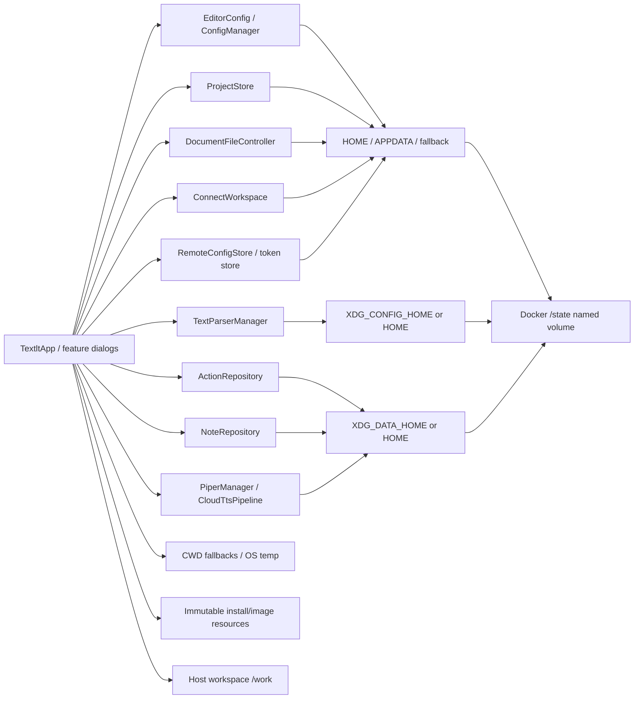
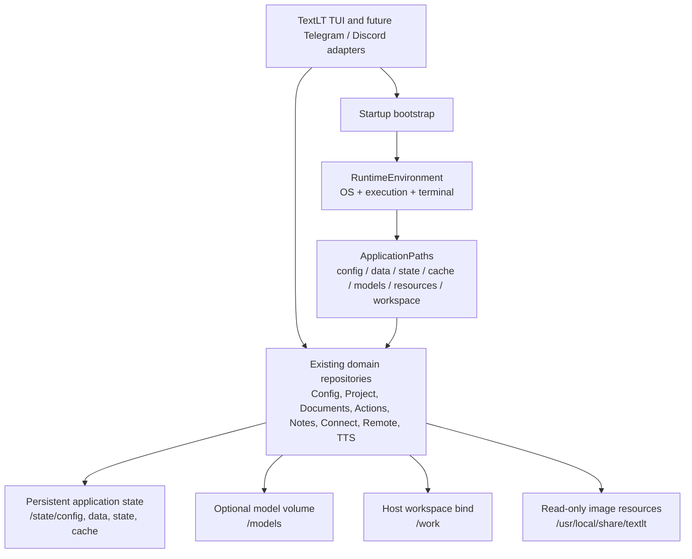
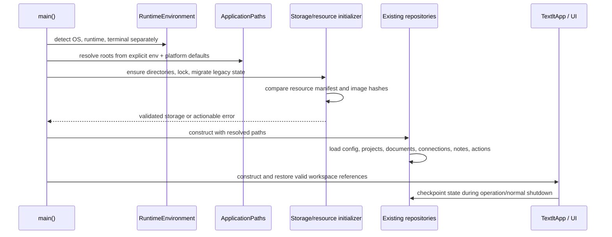
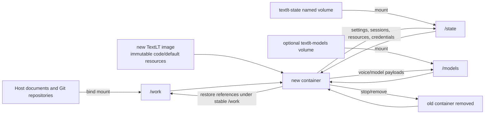
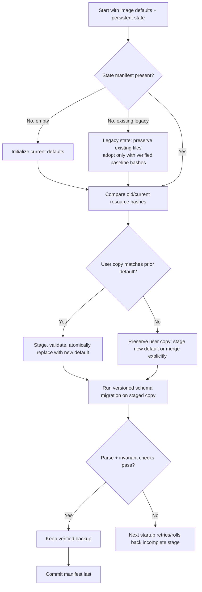

# TextLT Container Runtime and Persistent Storage Architecture Audit

**Repository baseline:** TextLT v1.1.0  
**Audit type:** source and architecture review; no implementation changes  
**Scope:** current application, storage, resources, Docker and deployment paths  

This report describes confirmed behavior in the repository separately from
proposed architecture. Source links below are relative to this document and
include line anchors for review.

## 1. Executive summary

TextLT already has a useful foundation for persistent container operation:

- `compose.yaml` mounts the host workspace at `/work` and a named volume at
  `/state`. These are separate, which is the correct boundary for user
  documents versus application state.
- The Docker image runs as a non-root user with `HOME=/state`. Most Linux
  application stores therefore resolve beneath `/state` even though the
  application does not currently receive explicit XDG variables.
- Settings, projects, editor session metadata, Actions, Notes, remote
  connections, Connect identity/configuration, custom processors, Piper data,
  and TTS library data already have file-backed stores.
- Several JSON writers use atomic replacement, and sensitive stores request
  private files on POSIX.

This is not yet a complete, centrally managed persistence architecture:

1. **Path resolution is decentralized.** `path_utils.hpp` only converts UTF-8
   paths. Each repository has its own HOME/XDG/platform logic. `XDG_CONFIG_HOME`
   is ignored by editor settings, projects, session state, themes, remote
   connections, and remote tokens, while other components honor it.
2. **The Docker `TEXTLT_CONTAINER` flag is not a general runtime mode.** It is
   read by Connect network diagnostics only. `TEXTLT_RUNTIME`,
   `TEXTLT_STATE_DIR`, and `TEXTLT_WORKSPACE_DIR` are not currently consumed.
3. **The current named volume does preserve most writes across container
   recreation, but image upgrades do not refresh resources inside an existing
   volume.** Dockerfile `COPY` instructions seed `/state` only when Docker
   initializes an empty volume. The volume then hides the image’s newer
   `/state` contents.
4. **Resource initialization is inconsistent.** The app creates a few
   directories/config files, text processors are copied only when missing,
   themes are read from either the user directory or one packaged directory,
   and Docker Actions/voice data are pre-seeded at image build. There is no
   unified resource manifest, content provenance, or upgrade reconciler.
5. **Workspace restoration is partial.** Open file paths, active document,
   cursor row/column, recents, favorites and non-empty untitled buffers are
   persisted. Pane assignments, layout mode, scroll positions, named
   unsaved-buffer contents, workspace mode and Connect conversation/draft
   state are not. Persisted paths are absolute paths in the process namespace.
6. **Sharing one writable state volume between simultaneous containers is not
   safe.** There is no single-instance or interprocess storage lock; generic
   atomic JSON writes use a predictable `.tmp` path. Last-writer-wins and
   temporary-file collisions are possible.

**Recommended direction:** preserve the existing repositories and formats,
but route their defaults through a small shared runtime/path resolver. Keep
the host workspace bind mount separate from state, retain current native paths
when no explicit container configuration is present, and migrate existing
container state conservatively. Add a resource manifest with per-resource
hashes and a user-modification policy before image upgrades begin updating
volume contents.

The current application version should remain **v1.1.0** for this work. Resource
and data-schema versions should be independent of the application release tag.

## 2. Existing architecture analysis

### 2.1 Initialization and shutdown

`main()` handles the CLI, calls `EnsureStartupResources()`, constructs
`TextltApp`, and then enters the UI loop. There is no global runtime-environment
object passed through startup. See
[`src/main.cpp`](../../src/main.cpp#L34-L80).

`TextltApp` loads `EditorConfig`, configured themes, the document controller,
remote connection store, and project store as members. The constructor loads
shortcuts and initializes project/workspace state. It restores opened documents
after constructing the editor panes. `Run()` stops Connect and saves Notes,
Actions and opened-session metadata after the UI loop returns:
[`src/app.cpp`](../../src/app.cpp#L77-L92),
[`src/app.cpp`](../../src/app.cpp#L412-L420),
[`src/app.cpp`](../../src/app.cpp#L558-L588),
[`src/app.cpp`](../../src/app.cpp#L706-L732).

`EnsureStartupResources()` creates the configured user theme directory and a
default config file; it does not initialize every store or reconcile default
resources. Assistant directories are created lazily when the assistant
settings dialog opens. Text processor user files are initialized lazily when
the processor UI or custom processor builder is opened. See
[`src/app_resources.cpp`](../../src/app_resources.cpp#L91-L126),
[`src/app_resources.cpp`](../../src/app_resources.cpp#L205-L222),
[`src/app_modals.cpp`](../../src/app_modals.cpp#L891-L899), and
[`src/modals/modal_text_processors/behavior.cpp`](../../src/modals/modal_text_processors/behavior.cpp#L20-L40).

Normal UI exit persists some state, but persistence is not equivalent to
durable recovery from an arbitrary container stop. The container has no
application-specific shutdown protocol in `Dockerfile` and no demonstrated
checkpoint guarantee if the process is terminated before `TextltApp::Run()`
returns. Named file edits are not copied into the session store. A SIGKILL,
host failure, or short stop grace period can therefore lose in-memory state.

### 2.2 Existing path/runtime mechanisms

| Existing mechanism | Actual responsibility | Assessment |
| --- | --- | --- |
| `src/path_utils.hpp` | UTF-8 conversion between `std::string` and `std::filesystem::path`. | Not an application path resolver. |
| `src/windows_environment_path.hpp` | Windows environment-variable-to-path helper. | Useful platform helper, not a runtime abstraction. |
| `EditorConfig::DefaultConfigPath()` | Resolves the main config path with platform-specific HOME/APPDATA logic. | A central point for settings only; does not govern other stores. |
| `app_resources.cpp` helpers | Independently resolve user config/data/cache and bundled processor resources. | Covers resources, but duplicates other path code. |
| `ConnectWorkspace::InspectLocalNetwork()` | Connect diagnostics classifies native Windows/macOS/Linux, WSL and a container using OS macros, environment variables and `/.dockerenv`. | Runtime detection exists only for Connect network diagnostics; unsuitable as the app-wide source of truth. |
| `ConfigManager`, `ProjectStore`, `ActionRepository`, `RemoteConfigStore`, `NoteRepository`, `PiperManager`, `CloudTtsPipeline` | Domain-specific stores, often with injectable paths in constructors. | Preserve these boundaries; centralize path selection and inject resolved paths rather than replacing their formats or repositories. |

There is **no existing centralized class** suitable for managing OS,
execution-environment and terminal-connection characteristics together.
`InspectLocalNetwork()` is feature-specific; `path_utils.hpp` is only a
conversion helper.

Current classification is split across compile-time and runtime checks:

- OS: `_WIN32`, `__APPLE__` and Unix/Linux preprocessor branches. Most
  filesystem choices are compile-time.
- WSL/container: Connect diagnostics uses Linux `uname`, `WSL_INTEROP`,
  `WSL_DISTRO_NAME`, `TEXTLT_CONTAINER`, `TEXTLT_CONTAINER_NETWORK` and
  `/.dockerenv`. The Docker image sets `TEXTLT_CONTAINER=1`.
- SSH/terminal connection: clipboard logic checks SSH environment markers and
  whether stdin/stdout are TTYs. The Docker launcher can explicitly enable
  terminal clipboard through `TEXTLT_TERMINAL_CLIPBOARD=1`.
- Docker does not imply a particular terminal or host network mode. These
  characteristics must remain separate.

See [`connect/ui/network_diagnostics.cpp`](../../connect/ui/network_diagnostics.cpp#L496-L536),
[`src/editor/clipboard_controller.cpp`](../../src/editor/clipboard_controller.cpp#L157-L165),
and [`docs/docker/run`](../docker/run#L17-L47).

### 2.3 XDG and explicit runtime variable audit

**Confirmed XDG consumers:**

- `XDG_CONFIG_HOME`: text processor config and saved search filters; Linux
  Downloads lookup also uses it for `user-dirs.dirs`.
- `XDG_DATA_HOME`: Actions on Linux, Notes on Linux, Piper, assistant registry
  data and Cloud TTS library data.
- `XDG_CACHE_HOME`: Piper runtime download archive and assistant download cache.
- `XDG_STATE_HOME`: no current application source reference found.

**Important inconsistency:** editor config, `document_files.json`, themes,
projects, remote connections and OAuth token paths use `$HOME/.config/textlt`
on non-Windows systems, not `XDG_CONFIG_HOME`. On a Linux process that sets
`XDG_CONFIG_HOME=/state/config`, text processors/search filters move to that
tree while those other stores stay under `$HOME/.config/textlt`.

**Explicit TextLT variables:**

| Variable | Current use |
| --- | --- |
| `TEXTLT_DATA_DIR` | Locates packaged text processors and packaged Piper executable resources. It is not the user data/model directory. |
| `TEXTLT_INITIAL_WORKSPACE` | Forces project selection/registration from the supplied path at startup. |
| `TEXTLT_CONTAINER` | Read by Connect diagnostics only; any presence marks the process as a container there. |
| `TEXTLT_CONTAINER_NETWORK` | Read by Connect diagnostics for the label `host`; the Docker launcher/Compose file does not set it. |
| `TEXTLT_TERMINAL_CLIPBOARD` | Clipboard opt-in in the terminal clipboard implementation. |
| `TEXTLT_RUNTIME`, `TEXTLT_STATE_DIR`, `TEXTLT_WORKSPACE_DIR` | No current source use found. |

Thus the proposed variables are not backwards-compatible features until
implemented centrally. Do not set the proposed XDG values in Docker before
fixing all consumers: it would split existing application data across old and
new locations.

## 3. Complete persistent storage inventory

Paths below show the current platform defaults. “Docker path” assumes the
current image values `HOME=/state`, no XDG variables, `/work` as the working
directory, and the `/state` named volume.

| Component | Source file and class | Current path | File format | Path resolution mechanism | Docker persistence status | Required changes |
| --- | --- | --- | --- | --- | --- | --- |
| General editor settings, theme selection/overrides, AI provider profiles/API keys, TTS preferences, sidebar/editor options, user-added file-modal directories | [`EditorConfig`](../../src/editor_config.cpp#L69-L112), [`ConfigManager`](../../src/config_manager.cpp#L48-L53) | Windows `%APPDATA%/textlt/config.json`; macOS/Linux `$HOME/.config/textlt/config.json`; fallback `$HOME/.textlt_config.json`; then CWD `config.json` if HOME is unavailable. | JSON; no single schema-version field. Legacy AI fields are parsed in `config_manager.cpp`; fallback config is selected, not migrated. | `EditorConfig::DefaultConfigPath()` and `ConfigManager::ResolveConfigPath()`. Linux/macOS ignore `XDG_CONFIG_HOME`. | `/state/.config/textlt/config.json` is under the volume. | Route through centralized config path; support XDG consistently; preserve legacy fallback with a non-destructive migration/copy and backup. Treat API keys as secrets. |
| Open files, active document, cursor row/column, recents, favorite files and favorite cursor positions | [`DocumentFileController`](../../src/editor/document_file_controller.cpp#L439-L483) | Same config directory, `document_files.json`. | JSON fields `recent_files`, `favorites`, `opened_files`, `active_opened_index`; no explicit schema version. | Controller-local `UserConfigDirectory()` and `DefaultStatePath()` at [`document_file_controller.cpp`](../../src/editor/document_file_controller.cpp#L767-L794). | `/state/.config/textlt/document_files.json` persists. Workspace file contents remain in `/work` or elsewhere, not copied here. | Centralize path; add versioned workspace state and explicit durability/recovery semantics. Keep existing JSON readable. |
| Unsaved untitled buffers | [`DocumentFileController::CurrentOpenedConfig`](../../src/editor/document_file_controller.cpp#L593-L639) | Embedded in `document_files.json` as memory-only `content`. | JSON text plus cursor row/column. | Same as editor session state. Only non-empty, non-temporary, non-read-only sessions qualify. | Persists on a successful session-state write, normally including clean exit. | Add crash-safe checkpoint policy; do not confuse this with recovery of named dirty files. |
| Named dirty document recovery | [`DocumentFileController`](../../src/editor/document_file_controller.cpp#L593-L639) | Not stored. Opened named sessions store path and cursor only; restoration reloads disk file at [`document_file_controller.cpp`](../../src/editor/document_file_controller.cpp#L490-L513). | None for modified buffer content. | None. | **Not guaranteed.** A modified named document can lose edits after an unclean stop. | Add journal/autosave recovery separate from the host document; offer restore/review instead of overwriting source files. |
| Editor panes, pane assignments, layout mode, per-pane scroll and workspace mode | [`DocumentWorkspace`](../../src/editor/document_workspace.hpp#L15-L74), [`EditorViewport`](../../src/editor/editor_viewport.hpp#L96-L109), [`LayoutController`](../../src/layout_controller.hpp#L15-L62) | In memory only. `document_files.json` does not serialize them. | None. | In-memory component state; startup defaults to one pane and syncs restored sessions to visible panes. | Lost on container recreation. | Persist only deliberately selected state in a versioned workspace record; test layout changes and stale pane indices. |
| Recent files and file favorites | [`DocumentFileController`](../../src/editor/document_file_controller.cpp#L451-L483) | `document_files.json`, absolute normalized paths; favorites also store cursor row/column. | JSON. | `NormalizeDocumentPath()` uses absolute/weakly-canonical paths. Missing recents are actively removed on load; missing opened files are skipped. | State survives; paths under a stable `/work` bind can resolve. Files outside mounted paths cannot. | Keep paths as references, not copies. Decide whether missing entries should remain recoverable rather than be dropped on next save. |
| Favorite directories / file-manager shortcuts | [`EditorConfig`](../../src/editor_config.cpp#L126-L175), [`TextltApp`](../../src/app_file_actions.cpp#L229-L286) | `file_modal_directories` in `config.json`; absolute normalized paths. Project roots separately live in `projects.json`. | JSON string array. | Main config path; no automatic mapping to `/work`. | Persists, but a saved host/native path may not exist in the container. | Document `/work` as the stable container namespace; report stale roots rather than rewrite paths automatically. |
| Project registry, active project and local roots | [`ProjectStore`](../../src/project_store.cpp#L18-L36), [`ProjectStore::Save`](../../src/project_store.cpp#L121-L147) | Windows `%APPDATA%/textlt/projects.json`; non-Windows `$HOME/.config/textlt/projects.json`; otherwise relative `projects.json`. Stores canonical absolute `local_root` and optional remote connection ID. | JSON with `version: 1`, active project ID, records. | ProjectStore-local platform logic; ignores XDG config. | `/state/.config/textlt/projects.json` persists. `/work` root is stable if mount target remains `/work`. | Centralize path. Keep host documents in the bind mount. Handle missing roots without silently activating an unrelated CWD. |
| Initial workspace selection | [`TextltApp::InitializeProjects`](../../src/app_projects.cpp#L16-L58) | `TEXTLT_INITIAL_WORKSPACE`, else persisted project, else `current_path()`. | Environment variable plus project JSON. | `TEXTLT_INITIAL_WORKSPACE` calls `ProjectStore::Add()` and makes that root active. | Docker sets it to `/work`; this is stable and useful. It can select a different host workspace if the bind source changes. | Keep compatibility with this variable; define precedence alongside `TEXTLT_WORKSPACE_DIR`. Avoid copying workspace files into state. |
| User keyboard shortcuts | [`ShortcutStore`](../../src/shortcut_store.cpp#L15-L27), [`ShortcutStore::Save`](../../src/shortcut_store.cpp#L52-L82) | `shortcuts.json` adjacent to main config. | JSON version 2; loader supports legacy `overrides` fallback. | Derives directory from `EditorConfig::DefaultConfigPath()`. | `/state/.config/textlt/shortcuts.json` persists. | Route through common path resolver; keep existing format. |
| Saved file-search masks and selected search directories | [`SearchFilesModalContent`](../../src/modals/modal_search_files/filters.cpp#L222-L259) | Windows `%APPDATA%/textlt/search_file_filter.json`; otherwise `XDG_CONFIG_HOME/textlt/search_file_filter.json`, else `$HOME/.config/textlt/search_file_filter.json`. Stores filters/selected directories. | JSON. | This component alone honors `XDG_CONFIG_HOME`. | Persists under `/state/.config` with current image; redirects if XDG is newly set. | Centralize path and migrate safely. **Search query history itself was not found.** |
| Actions (groups, pages, user-created/imported Actions, project grouping) | [`ActionRepository`](../../src/actions/action_repository.cpp#L27-L44), [`ActionSerializer`](../../src/actions/action_serializer.cpp#L24-L58) | Windows `%LOCALAPPDATA%/textlt/actions.json`; macOS `~/Library/Application Support/textlt/actions.json`; Linux `$XDG_DATA_HOME/textlt/actions.json`, else `~/.local/share/textlt/actions.json`; CWD `.textlt/actions.json` fallback. | JSON `textlt-actions`, schema version 2; v1 migration supported with `.v1.bak` backup. | Repository path is independently resolved. Linux honors XDG data. | `/state/.local/share/textlt/actions.json` persists with current HOME; Docker image seeds four Docker-specific Actions there for a new volume. | Centralize path; move seeding/upgrades to resource reconciliation. Keep user Actions intact. There is no general native built-in Actions catalogue in the packaged resource tree. |
| Text processor definitions, custom parser metadata, built-in pin state and user Lua scripts | [`TextParserManager`](../../src/text_parser_manager.cpp#L265-L343), pin writes at [`text_parser_manager.cpp`](../../src/text_parser_manager.cpp#L465-L527), builder at [`custom_processor_builder.cpp`](../../src/custom_processor_builder.cpp#L280-L300) | Windows `%APPDATA%/textlt`; non-Windows `$XDG_CONFIG_HOME/textlt`, else `~/.config/textlt`; CWD `.textlt` fallback. Files: `text_parsers.json`, `text_parsers/<id>.lua`. | JSON manifest plus Lua source; no unified resource generation manifest. | User config is initialized by copying packaged defaults only if missing. Individual `.lua` files are also copy-if-missing. | `/state/.config/textlt` persists. Existing copied files are not refreshed when image defaults change. | Centralize path; use managed immutable defaults plus user overlay/provenance. Existing user modifications must never be overwritten. |
| Quick text processor slots | [`TextProcessorsModalContent`](../../src/modals/modal_text_processors/quick.cpp#L3-L5), load/save at [`quick.cpp`](../../src/modals/modal_text_processors/quick.cpp#L38-L129) | `quick_text_commands.json` in TextParserManager user config directory. | JSON array of command IDs, names, parameters and repeat counts. | Same path as text processors. | Persists under `/state/.config/textlt`. | Include in schema/version migration and resource validation. |
| Themes | [`Theme` loader](../../src/theme.cpp#L320-L373), location ordering at [`theme.cpp`](../../src/theme.cpp#L406-L422) | User `$HOME/.config/textlt/themes`; packaged executable-relative paths, then CWD `themes`. Windows uses APPDATA. | One JSON file per theme; selected theme/overrides in `config.json`. | User directory is checked first; the first directory containing any usable JSON themes wins. The app does not copy packaged themes into user storage. | Packaged themes are immutable in `/usr/local/share/textlt/themes`; user themes under `/state/.config/textlt/themes` persist. | Make packaged/user precedence explicit and support a user overlay, so adding one custom theme does not hide future image themes. Verify macOS packaged lookup: this loader uses `/proc/self/exe` on non-Windows, unlike `app_resources.cpp`’s Apple-specific executable lookup. |
| Notes, note pins, sections/project association, Trash and local device ID | [`NoteRepository`](../../src/notes/note_repository.cpp#L41-L99), [`NoteSerializer`](../../src/notes/note_serializer.cpp#L14-L44) | Windows `%LOCALAPPDATA%/textlt/notes`; macOS `~/Library/Application Support/textlt/notes`; Linux `$XDG_DATA_HOME/textlt/notes`, else `~/.local/share/textlt/notes`; CWD `.textlt/notes` fallback. | `items/*.tlnote` (schema version 1), `sections.json`, `device_id`. Pin metadata lives in each note. | Notes-specific platform logic. The UI saves Notes on normal shutdown and during operations. | `/state/.local/share/textlt/notes` persists. | Centralize path; preserve IDs and schema. Notes revision/device metadata does not implement automatic sync; docs state cross-device Notes sync is outside the workflow. |
| AI provider profiles, API keys, selected model and reasoning effort | [`EditorConfig`](../../src/editor_config.hpp#L13-L42), serialization in [`editor_config.cpp`](../../src/editor_config.cpp#L85-L110); backend at [`ai_backend.hpp`](../../src/ai/ai_backend.hpp#L12-L56) | Same `config.json` as general settings. | JSON strings/maps; API keys are stored in the config file. | EditorConfig path; POSIX private-file atomic write requested. | Persists at `/state/.config/textlt/config.json`. | Protect in backups and document plaintext-at-rest risk. Use secure file permissions/ACLs. |
| AI model catalogs, local models, prompts and AI sessions | [`AiBackend`](../../src/ai/ai_backend.cpp#L591-L707), Quick AI definitions in [`modal_quick_ai.cpp`](../../src/modals/modal_quick_ai.cpp#L25-L45) | Model catalogs are queried from configured providers; Ollama models are on the externally managed Ollama host. ChatGPT uses external `codex` CLI. No TextLT model registry/session store or saved prompt-template file was found. | Runtime API/CLI responses; prompt modes are source-defined. | Provider endpoint/model configured in `config.json`; external services own their data/auth. | TextLT settings persist; external models/auth persist only if their own server/home is separately persistent. | State clearly that AI models and provider auth are external. No AI session restoration exists. No terminology dictionary store or user prompt-template store was found. |
| Piper voice registry, downloaded voice models/configs, runtime executable and logs | [`PiperManager`](../../src/piper_manager.cpp#L332-L407), voice paths at [`piper_manager.cpp`](../../src/piper_manager.cpp#L429-L493), logs at [`piper_manager.cpp`](../../src/piper_manager.cpp#L206-L209) | Data root is `%LOCALAPPDATA%/textlt` on Windows; `$XDG_DATA_HOME/textlt` else `~/.local/share/textlt`. Subdirs `registries`, `piper/models`, `piper/bin`, `piper/logs`. Download archives use XDG cache or `~/.cache/textlt`. | JSON voice index; model/config assets; executable archives; log files. | PiperManager’s own XDG/platform helpers; bundled fallback executable uses `TEXTLT_DATA_DIR`. | Voice registry/models/runtime data under `/state/.local/share/textlt`; download cache under `/state/.cache/textlt`. Docker’s bundled runtime is immutable under `/usr/local/share/textlt`; a symlink is seeded in an empty volume. | Centralize path and distinguish immutable image runtime from user-downloaded runtime/voices. Optional model mount needs a dedicated models override; changing XDG data would move unrelated app data too. |
| Cloud TTS book metadata, chunk state and generated audio | [`CloudTtsPipeline`](../../src/cloud_tts_pipeline/paths_persistence.cpp#L21-L73), write/read at [`paths_persistence.cpp`](../../src/cloud_tts_pipeline/paths_persistence.cpp#L120-L235) | `XDG_DATA_HOME/textlt/tts/library/books/<book-id>` or `~/.local/share/textlt/tts/library/books/<book-id>`. | `book.json`, `chunks.json`, WAV chunk files. Book ID derives from source path or text. | CloudTtsPipeline-specific data path; source paths are recorded in metadata. | Persists under `/state/.local/share/textlt`. | Separate user library metadata from regenerable audio cache if desired; keep source docs in `/work`. Stable `/work` paths help book identity remain stable. |
| TTS player/voice preferences and player test WAV | Preferences in [`EditorConfig`](../../src/editor_config.cpp#L85-L100); test audio in [`modal_tts/player.cpp`](../../src/modals/modal_tts/player.cpp#L9-L15) | Preferences in `config.json`; generated player test WAV under `<data>/textlt/tts/player_test.wav`. | JSON fields and WAV. | Config path plus Piper user data path. | Both persist under current `/state` layout. Test WAV is regenerable. | Put regenerable test output in cache if relocating data; do not treat it as a user document. |
| Connect settings, local identity, saved TextLT peer profiles and auto-accept entries | [`ConnectWorkspace`](../../src/app.cpp#L575-L590), settings at [`connect_settings.cpp`](../../connect/ui/connect_settings.cpp#L98-L146), profiles at [`connect_profiles.cpp`](../../connect/ui/connect_profiles.cpp#L171-L222) | Identity PEM is passed as `EditorConfig::DefaultConfigPath().parent_path()/localsend.pem`; `connect-settings.json` and `textlt-connections.json` share that directory. | PEM certificate/private key; JSON settings and profile array (profile schema version 1). | Editor config parent path; no independent path service. Identity PEM is created with owner-only permissions on POSIX by [`connect/src/identity.cpp`](../../connect/src/identity.cpp#L32-L85). | `/state/.config/textlt` persists, including identity and profiles. | Centralize path; protect keys and backup them. Profiles are distinct from saved SFTP/FTPS profiles. |
| Connect conversation history, drafts, selected conversation and transfer state | [`ConnectWorkspace::Conversation`](../../connect/ui/connect_workspace.hpp#L113-L139) | In-memory only. `docs/connect-architecture.md` explicitly says transfer/import history is scoped to the current editor session. | None. | Runtime UI state. | Lost on recreation; not application configuration. | Decide whether durable chat history is a product requirement. Do not imply it is currently persisted. |
| Remote SFTP/FTPS/Dropbox connection profiles and credentials | [`RemoteConfigStore`](../../src/remote/remote_config_store.cpp#L34-L53), serialize/save at [`remote_config_store.cpp`](../../src/remote/remote_config_store.cpp#L260-L314) | Windows `%APPDATA%/textlt/remote_connections.json`; non-Windows `$HOME/.config/textlt/remote_connections.json`. Includes passwords, key passphrases, app secrets and path references. | JSON; no explicit schema version. Saved using private-file mode on POSIX. | Store-local path logic; ignores XDG config. | `/state/.config/textlt/remote_connections.json` persists. | Centralize path; consider secret separation/OS key stores in future; include permissions and backup handling. |
| Dropbox OAuth tokens | [`RemoteOAuthTokenStore`](../../src/remote/remote_oauth_token_store.cpp#L156-L204), serialized at [`remote_oauth_token_store.cpp`](../../src/remote/remote_oauth_token_store.cpp#L85-L111) | Sibling `remote_tokens/<provider>-<slug>.json`, ordinarily under remote config directory. | JSON tokens; private-file atomic save. | Separate HOME/APPDATA resolver; default Dropbox import may use `remote_config.parent/remote_tokens`. | Persists under `/state/.config/textlt/remote_tokens`. | Centralize path and include token files in backup/restore/security tests. |
| SSH config/identity/known-host references | [`DefaultSshConfigPath`](../../src/remote/remote_ssh_config.cpp#L243-L257), remote settings in [`remote_connection_config.hpp`](../../src/remote/remote_connection_config.hpp) | `~/.ssh/config`, default known_hosts/key paths or user-supplied external paths. Actual key files are not copied by TextLT. | OpenSSH text files and key material. | `HOME`/`USERPROFILE`; remote profile stores paths/host aliases. | `HOME=/state` makes `/state/.ssh` eligible for persistence, but launcher does not separately import/mount the host’s SSH directory. | Document key-file placement/mounts; do not claim keys referenced outside `/state` survive. |
| Git remotes, repository config, local identity and global identity | [`GitManager`](../../src/git_manager.cpp#L481-L512), commands run relative to its configured working directory. | Repository `.git/config` and objects under workspace; global Git config normally `~/.gitconfig`. Git credential helper state is external to TextLT. | Git-native config/objects/credentials. | Invokes installed `git`; project root comes from `ProjectStore`. | `/work/.git` remains on host bind mount; `/state/.gitconfig` persists with `HOME=/state`. Host credential stores are not mounted by default. | Keep repositories in `/work`; explicitly document which credential/helper state is external. |
| Local and remote file operations / remote cached copies | [`FileManager`](../../src/file_manager.cpp#L768-L863), remote temporary path at [`state_utils.cpp`](../../src/remote/modal_remote_files/state_utils.cpp#L83-L94) | User-selected destination or current workspace. Temporary remote downloads use `std::filesystem::temp_directory_path()` and `textlt-remote-*`. | User file bytes; temporary files. | User path/current directory or OS temp. | `/work` writes persist through host bind; `/tmp` downloads do not survive replacement. | Preserve user docs in workspace. If remote cache restoration is required, make cache metadata explicit and durable; do not assume `/tmp` is persistent. |
| Downloads destination | [`FileManager::UserDownloadsDirectory`](../../src/file_manager.cpp#L820-L857) | Windows known Downloads folder; Linux parses XDG `user-dirs.dirs`; else `$HOME/Downloads`; other platforms home Downloads. | Arbitrary downloaded files. | XDG config path or platform/home fallback. Dockerfile creates `/state/.config/user-dirs.dirs` with `/work/Downloads`. | Docker routes downloads to workspace if that directory exists/config is read. | Keep this host-workspace behavior; test with and without `/work/Downloads`. |
| Logs and debug output | [`PiperManager`](../../src/piper_manager.cpp#L206-L209); [`Logger`](../../src/logger.hpp#L32-L57); debug import dump in [`app_modals.cpp`](../../src/app_modals.cpp#L482-L510) | Piper logs under app data. `Logger` opens `debug.log` relative to CWD (overwrites on start); no `LOG()` call site was found in current C++ sources. Imported text is also written to fixed `/tmp/textlt_inserted.txt`. | Text logs/debug dump. | CWD, data path or fixed OS temp. | Piper logs persist; `debug.log` would be under `/work` if logger is used; `/tmp/textlt_inserted.txt` is ephemeral and contains imported text. | Audit/remove or gate debug dumps; avoid placing logs in user workspace. If logging is enabled, route to state with rotation and privacy controls. |
| Temporary HTTP/FTPS/process files | [`RemoteHttpClient`](../../src/remote/remote_http_client.cpp#L24-L43), [`RemoteCommandRunner`](../../src/remote/remote_command_runner.cpp#L755-L780), [`RemoteFtpsProvider`](../../src/remote/remote_ftps_provider.cpp#L71-L99) | `std::filesystem::temp_directory_path()`. Some temporary FTPS config files contain auth data and are created mode 0600 on POSIX. | Temporary files, not a recovery store. | OS temp directory; cleanup is operation-specific. | Not persistent; container removal discards writable layer `/tmp`. | Keep transient files out of persistent state. Test cleanup and secret permissions; use state only for intentional resumable transfers. |

### 3.1 Requested feature verification

| Requested area | Current finding |
| --- | --- |
| General editor settings | Implemented in `config.json`. |
| Open documents, active document, cursor positions | Implemented partially in `document_files.json`; no pane/layout/scroll persistence. |
| Editor sessions/workspace layout/editor panes | Sessions are partially persisted; pane assignments/layout/workspace mode are not. |
| Recent files/favorite files/favorite directories | Implemented; absolute paths. Search query history was not found. |
| Pinned files/directories | Editor favorite files and favorite directories exist. Notes have per-note pin fields; text processors have pin state. No separate general pinned-directory store was found. |
| File manager root directories | Project roots and initial CWD are used; no independent root registry beyond projects and favorites. |
| Project configs | Implemented in `projects.json`; local roots are absolute paths. |
| Custom keyboard shortcuts | Implemented in `shortcuts.json`. |
| Built-in/user/imported Actions | User/imported Actions and project groups are supported. The Docker repo ships a Docker action seed file; no native packaged built-in Actions catalogue was found. |
| Action configs/scripts | Actions are JSON text data. No separate Action script runtime/store was found. |
| Text processors/Lua/custom parsers | Built-ins are C++ and immutable package resources; user definitions and Lua scripts are persisted. |
| Dictionaries/terminology | No persistent user dictionary/terminology store was found. |
| Prompt templates | AI modes/prompts are source-defined; no saved prompt-template repository was found. |
| Connect configuration/profiles | Implemented in Connect settings/profile JSON and PEM identity. Conversation/drafts are session-only. |
| Remote FTP/SFTP/SSH/Dropbox profiles | Implemented in `remote_connections.json`; secrets may be inline, tokens in separate files; referenced SSH keys remain external. |
| Git integration settings | Git writes native repository/global config. It is not a TextLT-managed database. |
| AI provider settings | Implemented in editor config. Model registry is fetched from provider; local Ollama models are external. AI session history is not persisted. |
| TTS config/voices/runtime | Implemented; voice registry, model/config files, downloadable runtime and logs use data/cache paths. |
| Notes/sync settings | Notes data and local device ID persist. Automatic cross-device synchronization settings/engine were not found; Connect can transfer snapshots. |
| Custom themes/templates | Custom themes persist in the user theme folder. General user-created template storage was not found. |
| Recovery/autosave | Only non-empty untitled buffers are embedded in session state. Named dirty buffers have no crash-recovery copy. |

## 4. Existing Docker persistence coverage

### 4.1 Current contract

- `compose.yaml` binds host workspace to `/work`, mounts the named volume
  `textlt-state` at `/state`, and allows a configurable volume name through
  `TEXTLT_STATE_VOLUME`: [`compose.yaml`](../../compose.yaml#L1-L23).
- The image creates `/state`, `/state/.config`, and `/work` for the configured
  non-root UID/GID; it sets `HOME=/state`, `TEXTLT_DATA_DIR=/usr/local/share/textlt`,
  `TEXTLT_INITIAL_WORKSPACE=/work`, `TEXTLT_CONTAINER=1`, and `WORKDIR=/work`:
  [`Dockerfile`](../../Dockerfile#L55-L86).
- The image installs immutable themes and text processors under
  `/usr/local/share/textlt`, bundles the Piper runtime there, and seeds voice
  registry and Docker Actions files into `/state/.local/share/textlt`:
  [`Dockerfile`](../../Dockerfile#L49-L76),
  [`CMakeLists.txt`](../../CMakeLists.txt#L380-L396).
- Docker’s launcher uses `docker run --rm -it`, mounts `/work` and the named
  `/state` volume, and supports explicit clipboard choices:
  [`docs/docker/run`](../docker/run#L49-L79).
- `.dockerignore` excludes most docs but includes `docs/registries` and
  `docs/docker`, which are used by image build stages:
  [`.dockerignore`](../../.dockerignore#L1-L24),
  [`Dockerfile`](../../Dockerfile#L26-L36).
- Docker runtime is non-root. Fresh volume contents inherit image ownership.
  A reused volume keeps its old ownership; changing `TEXTLT_UID`/`TEXTLT_GID`
  later does not automatically chown an existing named volume.

### 4.2 What does and does not survive

**Survives normal container removal/recreation when using the same named
volume:** files under `/state`, including most current config/data/cache
locations because HOME is `/state`; workspace files under `/work` survive on
the host bind mount. `docker run --rm` removes the container, not the named
volume. Compose’s named volume is not removed by ordinary `docker compose
down`; `down -v` is destructive.

**Does not necessarily survive:** `/tmp`, image-layer-only files not seeded
into the volume, any referenced SSH/API/credential files outside `/state`, and
in-memory sessions on abnormal termination.

### 4.3 Upgrade, permission, concurrency and network gaps

- **Image upgrade:** an empty named volume is initialized from `/state` in the
  image. Once non-empty, the mounted volume masks the image’s `/state`; new
  Docker Actions, voice registries and links added in a later image are not
  copied into that existing volume. There is no runtime merge/upgrade step.
- **Resource freshness:** the bundled runtime in `/usr/local/share/textlt`
  can update with the image; the volume’s existing symlinks may continue to
  point there. The user voice registry and Docker Actions seed do not receive
  equivalent refresh semantics.
- **Permissions:** `--build-arg TEXTLT_UID/GID` helps align a fresh volume.
  Existing volumes may be owned by a previous UID. Host-directory bind mounts
  for state can have ownership/permission mismatch. The startup check verifies
  application storage writability but does not repair ownership.
- **Multiple containers:** no state lock or transactional multi-file update
  exists. Do not run multiple writers against one `/state` volume.
- **Backups:** no automated backup/restore workflow or state export/import
  guide was found in `docs/docker/`.
- **Networking:** Compose and `docs/docker/run` do not publish Connect’s
  default TCP/UDP ports or select host networking. Bridge mode can restrict
  inbound Connect/LocalSend discovery even though outbound network access
  works. Network diagnostics can label host networking only if
  `TEXTLT_CONTAINER_NETWORK=host` is set; the launcher currently does not set
  that variable.
- **Clipboard:** launcher supports terminal clipboard, X11 and Wayland
  forwarding; this is operational integration, not persistent application
  state.
- **CI coverage:** `.github/workflows/docker.yml` builds Linux/amd64 and runs
  `--startup-check` plus a container shell smoke test. It checks writable
  `/state`, non-root, `/work`, bundled tools and seeded Actions, but does not
  attach/reuse a named volume across container replacement or image upgrade:
  [`.github/workflows/docker.yml`](../../.github/workflows/docker.yml#L56-L90).
- **Release workflow:** Docker publication is invoked after stable release
  creation; it does not run a persistence lifecycle acceptance test:
  [`.github/workflows/release.yml`](../../.github/workflows/release.yml#L369-L377).

## 5. Identified defects and architectural gaps

1. **Duplicated path rules and inconsistent XDG compliance.** Two components
   can store related state in different trees after an operator sets XDG
   variables. `XDG_STATE_HOME` is unused.
2. **No app-wide environment model.** Filesystem code cannot consistently
   distinguish OS, container/WSL/native execution, and local/SSH/container
   terminal connection.
3. **No declared canonical storage contract.** Docker currently relies on
   `HOME=/state` and un-set XDG defaults. The proposed `/state/config`,
   `/state/data`, `/state/state`, `/state/cache` layout is not implemented.
4. **Volume initialization is mistaken for ongoing resource management.**
   Dockerfile seeds do not update an existing volume. Text processor
   copy-if-missing avoids clobbering, but also prevents default updates.
5. **No resource provenance or merge rules.** TextLT cannot distinguish an
   untouched copy from a user-edited copy after the initial copy.
6. **Partial recovery.** Pane/scroll state and named dirty document contents
   are absent. Restore skips missing files and subsequent persistence can
   remove those opened-file references.
7. **Absolute paths are namespace-specific.** A host path is not available
   inside the container unless mounted at the same container path. Persisted
   paths are not host/container path pairs.
8. **Potential accidental workspace state.** CWD fallbacks and `debug.log`
   can create files in `/work`; the fixed `/tmp/textlt_inserted.txt` debug dump
   writes imported text outside managed state.
9. **Sensitive data is part of ordinary state backups.** API keys, remote
   passwords/passphrases, tokens and private identity material must be
   protected. POSIX private file flags help but do not encrypt a volume.
10. **Atomic writes are not a full transaction/recovery protocol.** Generic
    JSON writes use predictable `<path>.tmp`; no cross-process lock exists.
    Some writes truncate directly. A crash between related files can leave
    partial migration state.
11. **Runtime/external resources are outside TextLT ownership.** Ollama model
    storage, Codex CLI login, Git credential helpers, SSH key files and
    external provider state need their own persistent mounts/services.
12. **Network reachability is not covered by storage.** Default Docker bridge
    configuration does not automatically expose Connect listener ports or
    multicast.

## 6. Proposed runtime environment architecture

### 6.1 Characteristics must remain orthogonal

Introduce a small immutable `RuntimeEnvironment` value (name illustrative)
with separate fields:

- **OS:** Windows, macOS, Linux, or another supported Unix target. Prefer
  compile-time facts where they are authoritative.
- **Execution environment:** native, WSL, or container. Explicit
  `TEXTLT_RUNTIME=container` should take precedence over heuristic detection;
  `/.dockerenv`/cgroup checks may be diagnostic fallback only.
- **Terminal connection:** local terminal, SSH terminal, container TTY, or
  unknown. Derive from TTY state plus explicit terminal variables; do not infer
  container from SSH or vice versa.

`TEXTLT_CONTAINER` is currently a coarse diagnostic switch. Keep it as a
compatibility alias while defining precedence, or deprecate it only after the
Docker image is updated. Avoid scattered `getenv("TEXTLT_RUNTIME")` checks.

### 6.2 Centralized path resolution, without replacing stores

Add one `ApplicationPaths`/`StoragePaths` value owned by startup and derived
from `RuntimeEnvironment` and environment configuration. It should return
resolved roots for config, data, state, cache, models, immutable resources and
workspace. Existing stores continue owning serialization and domain behavior;
their constructors already accept paths in several cases. Extend remaining
path accessors to use this object or inject resolved paths.

Recommended container contract:

```text
TEXTLT_RUNTIME=container
TEXTLT_STATE_DIR=/state
TEXTLT_WORKSPACE_DIR=/work
XDG_CONFIG_HOME=/state/config
XDG_DATA_HOME=/state/data
XDG_STATE_HOME=/state/state
XDG_CACHE_HOME=/state/cache
```

Keep `HOME=/state` for external tools (Git global config, Codex CLI and
OpenSSH), and preserve `/usr/local/share/textlt` as immutable image resources.
`TEXTLT_DATA_DIR` must continue to mean immutable packaged data; do not
repurpose it as writable user data.

Honor explicit XDG variables on Linux/macOS consistently, with defaults
matching current native paths when unset. Windows should retain APPDATA/
LOCALAPPDATA semantics unless a deliberate Windows override is specified.
The runtime mode is opt-in: ordinary native installations must not begin
writing beneath a container path.

### 6.3 Current versus proposed storage diagrams

#### Diagram 1 — current storage architecture



This is confirmed architecture: independent components resolve paths
themselves. Docker’s common HOME and volume make many current defaults land
inside `/state`, but do not make each component honor an explicit unified
layout.

#### Diagram 2 — proposed centralized architecture



No domain repository should perform its own container detection. Future
adapters use the same path/storage object; the UI is not the storage authority.

## 7. Proposed persistent storage architecture

### 7.1 Directory structure and ownership

The proposed structure is feasible and preserves the current conceptual
separation:

```text
/state/
├── config/textlt/   # preferences, profiles, shortcuts, user overlays
├── data/textlt/     # Actions, Notes, registries, persistent user data
├── state/textlt/    # editor session and resumable application state
├── cache/textlt/    # regenerable downloads and transient indexes
└── models/
    ├── ai/
    └── tts/
```

For a low-risk rollout, keep `HOME=/state` while adding explicit XDG values.
Then route every TextLT-owned store through the same resolver. Do not simply
set XDG values in Docker first: today, editor settings/projects/remote stores
would remain at `/state/.config/textlt` while text processors/search filters
would move to `/state/config/textlt`.

Suggested classification:

- **Config:** preferences, provider settings, remote connection profiles,
  keyboard shortcuts, user text processor definitions and user themes.
- **Data:** Actions, Notes, resource registries, persistent TTS book library
  metadata, user-owned application data.
- **State:** active workspace/document/session metadata, cursor/scroll/pane
  state, recovery journal, migration/resource manifest.
- **Cache:** re-downloadable archives, transient indexes and disposable
  network data. Avoid putting user-authored scripts or only copies of
  important files here.
- **Models:** large TTS voice files and any future TextLT-managed local models.
  Current TextLT does not download/manage Ollama’s model store; that belongs
  to the Ollama service/host unless a future feature explicitly takes
  ownership.
- **Workspace:** `/work` remains the host-owned source of documents and Git
  repositories. Do not duplicate it into `/state`.

Current TTS audio and book/chunk metadata are in the user data tree. Moving
WAVs to a cache is only safe if the library can regenerate them and metadata
clearly marks missing audio. Keep them in data until that behavior is proven.

### 7.2 Named volume, optional model volume, host bind alternative

- **Default:** retain `textlt-state:/state` (existing volume name and mount
  point). This preserves current deployment semantics and supports the target
  directory tree.
- **Optional large model volume:** consider a separate `textlt-models:/models`
  for Piper voices and future application-managed models. Add a dedicated
  `TEXTLT_MODELS_DIR=/models` only as part of centralized path support; do not
  overload `XDG_DATA_HOME` or `TEXTLT_DATA_DIR`. Keep registry metadata in
  `/state/data` and model payloads in `/models`.
- **Host state directory alternative:** an optional bind mount such as
  `${TEXTLT_STATE_DIR}:/state` allows direct inspection and filesystem
  backups. It requires documented ownership/UID setup and a preflight check;
  unlike a named volume, it does not inherit image ownership automatically.
  Keep this optional and separate from `${TEXTLT_WORKSPACE}:/work`.
- **Multiple containers:** document one active writer per state volume unless
  interprocess locking and transaction semantics are added.
- **Backup:** recommend stopping TextLT or taking a consistent volume
  snapshot before backup. Include secrets and model assets deliberately;
  support restoring `/state` and `/models` independently. Never include
  `/work` in an automatic state backup unless requested.

## 8. Workspace restoration and path consistency

### 8.1 What is restored today

`document_files.json` stores opened paths and cursor row/column, the active
opened-file index, recent files, favorite files and favorite cursor positions.
Non-empty untitled buffers are stored with content. `RestoreOpenedSessions()`
reopens existing regular files and assigns the active session to the active
pane. `EditorViewport` does have scroll state in memory, but the session
serializer does not include it.

Projects store canonical absolute local roots. `TEXTLT_INITIAL_WORKSPACE`
selects `/work` in Docker. File-modal favorite directories are separate
absolute paths in editor config. Git reads/writes repository metadata at the
project root; the workspace bind mount therefore preserves `.git`.

### 8.2 Path behavior across container replacement

- `/work/file.txt` remains valid if the host directory is mounted at `/work`
  on every launch. This is the recommended and stable container path.
- A persisted path such as `/home/alice/docs/file.txt` from a native
  installation is not automatically equivalent to `/work/file.txt`. Do not
  rewrite paths based on string heuristics; the mapping is user/deployment
  specific.
- Files opened outside `/work` may refer to ephemeral container files or
  unmounted paths. Store references, not duplicate document contents, except
  explicit recovery buffers.
- A missing opened file is skipped during restoration. Recent files are
  removed if missing. Favorites and projects can remain stale. Proposed
  behavior should surface a missing reference and preserve it until the user
  resolves/removes it, rather than silently deleting recoverable metadata.
- A project root that cannot be opened falls back to the current process
  directory in `InitializeProjects()`. In a container that can mean `/work`;
  make the fallback visible rather than silently changing project context.
- `weakly_canonical()` may resolve symlinks. If a symlink points outside
  `/work`, the resolved absolute target may not exist in the next container.
  Keep symlink semantics explicit; do not auto-rewrite persisted paths.
- Remote files opened through the remote-file dialog are cached under the OS
  temp directory. Their local temp path and remote mapping are in-memory; they
  are not a durable remote-document identity.
- Unsaved named-document edits are not recovered by current session storage.
  A recovery journal should be separate from the source file, preserve the
  source path/mtime/hash, and offer restore/compare rather than auto-overwrite.

### 8.3 Proposed workspace record

Add a versioned workspace-state document under the state root, preserving
current document/session formats where feasible. Candidate fields:

- workspace identifier and stable root path;
- ordered open document references;
- active document and active pane;
- layout mode and pane-to-document assignments;
- cursor row/column and scroll offsets per pane;
- dirty recovery journal references (not full source-file copies);
- missing/unavailable status for paths and remote references.

Only persist layout/state that is useful to users. Exclude ephemeral mouse
selection, modal state, active network transfer objects and Git compare
temporary documents.

## 9. Resource initialization and migration strategy

### 9.1 Current behavior

| Resource | Current initialization and upgrade semantics |
| --- | --- |
| Packaged themes and text processors | Installed with CMake under `${CMAKE_INSTALL_DATADIR}/textlt`; Docker copies them into the immutable image location. They can update with a new image. |
| User themes | `EnsureStartupResources()` creates the directory but does not seed or merge it. Loader picks the first usable directory; user themes can shadow the packaged theme set. |
| Default config | Created if missing. There is a legacy `.textlt_config.json` fallback, but ConfigManager selects it rather than migrating it to the preferred path. |
| User text processor files | On-demand `EnsureUserConfiguration()` copies default manifest and Lua files only when missing. Existing files never receive new defaults or updates. |
| Docker Actions | `docs/docker/actions.json` is copied into `/state/.local/share/textlt/actions.json` at image build. It is not an app-start resource installer. |
| Piper voice registry | Docker copies `docs/registries/piper_voices_index.json` into `/state`; user-triggered downloads can update registry files. Existing volume is not reconciled against image version. |
| Piper executable | Docker image contains a bundled immutable runtime; user-downloaded runtime uses user data/cache paths. |
| Schema migration | Actions supports schema v1→v2 and backup. Notes schema is v1. Shortcut file v2 loader falls back to older overrides. Project JSON writes version 1. Editor config and remote config have compatibility logic but no unified schema version/migration coordinator. |

Sources: [`app_resources.cpp`](../../src/app_resources.cpp#L100-L126),
[`text_parser_manager.cpp`](../../src/text_parser_manager.cpp#L293-L343),
[`action_repository.cpp`](../../src/actions/action_repository.cpp#L46-L74),
[`action_serializer.cpp`](../../src/actions/action_serializer.cpp#L24-L58),
[`project_store.cpp`](../../src/project_store.cpp#L121-L147),
[`note_serializer.cpp`](../../src/notes/note_serializer.cpp#L74-L110),
[`Dockerfile`](../../Dockerfile#L49-L76).

### 9.2 Recommended upgrade model

Do not overwrite a user-visible file merely because the application version
changed. Put packaged defaults in the immutable image and maintain an
independent manifest under state:

```text
resource_id
resource_schema_version
packaged_content_sha256
installed_default_sha256
user_override_sha256 (optional)
last_successful_migration
```

Recommended algorithm:

1. **First start with empty storage:** initialize directory tree, install
   current defaults/seed resources, write the manifest last.
2. **Existing state with a known manifest:** compare the previous installed
   hash to the current installed hash.
   - If the user copy still matches the previous installed hash, update it to
     the new default atomically.
   - If it differs, preserve the user copy; stage the new default alongside
     it or perform a type-specific merge with an explicit backup.
3. **Existing legacy volume without a manifest:** treat existing files as
   user-owned unless a trustworthy old baseline checksum proves they are
   unchanged. Never infer provenance from TextLT version alone. For
   v1.1.0-seeded Docker files, an explicitly reviewed legacy checksum catalog
   may permit safe adoption; otherwise preserve the file and install new
   defaults separately.
4. **Schema migration:** migrate to a temporary file, validate it, preserve a
   backup, atomically replace the destination, and update the schema marker
   only after successful replacement.
5. **Interrupted initialization:** make each operation idempotent. Stage
   resource writes, validate hashes, rename atomically, and commit the
   manifest last. On next start, detect incomplete stages and retry or roll
   back without deleting the source.
6. **Configuration compatibility:** keep current JSON field names and use
   additive migrations. A path migration should copy/verify before changing
   the active path; retain old data until successful validation and a
   documented cleanup window.

`WriteJsonAtomically()` already gives a useful primitive: parent creation,
temporary write and replacement. However, non-private writes use a predictable
`.tmp`; there is no process lock or transaction across multiple files, and the
POSIX path does not fsync the file and parent directory. Some stores still use
direct truncating writes. Improve the shared primitive before relying on it
for unattended migration. See [`json_utils.hpp`](../../src/json_utils.hpp#L47-L110),
[`text_parser_manager.cpp`](../../src/text_parser_manager.cpp#L465-L527), and
[`note_serializer.cpp`](../../src/notes/note_serializer.cpp#L46-L69).

## 10. Docker integration recommendations

1. Keep the existing workspace bind mount and named state volume as separate
   mounts. Do not place user documents under `/state`.
2. Add explicit container runtime/state/workspace/XDG variables only after
   every app-owned store uses centralized path resolution.
3. Retain `HOME=/state` for external tools; document that `~/.ssh`,
   `~/.gitconfig`, and Codex CLI authentication under HOME are persistent only
   if actually written under `/state`.
4. Add an optional model mount only after a dedicated model path is supported.
   Keep application config and small registries in `/state`.
5. Document named-volume backup/restore, state bind-mount alternative,
   ownership requirements, `down -v` data-loss behavior, and one-writer
   expectation.
6. Add a container lifecycle job that creates a named volume, writes marker
   state, replaces the container/image, reuses the volume, and checks both
   preservation and resource upgrade behavior.
7. Add a resource manifest/initializer before expecting new image defaults to
   appear in an old volume.
8. Keep network/clipboard configuration distinct from storage. Document
   bridge networking and optional Connect port publication/host networking
   separately.
9. Startup diagnostics should list resolved writable directories and report
   read/write/rename errors without printing secret values. Extend
   `--startup-check`, which already checks a subset of paths:
   [`startup_check.cpp`](../../src/startup_check.cpp#L177-L220).
10. Preserve the existing launcher's `TEXTLT_INITIAL_WORKSPACE` and
    `TEXTLT_TERMINAL_CLIPBOARD` behavior during any Docker changes.

## 11. Architecture diagrams

#### Diagram 3 — proposed application startup and storage initialization



#### Diagram 4 — container replacement and restoration



The persistent identity is the volume plus stable in-container mount paths, not
the container ID. Rebinding a different host directory to `/work` intentionally
changes the content behind that namespace.

#### Diagram 5 — default resource upgrade and migration



## 12. Implementation roadmap

The increments below are proposals, not implemented changes.

### Increment 1 — central path/runtime characterization (recommended first)

- **Objective:** stop path drift before changing Docker’s on-disk layout.
- **Files/classes:** add a small runtime/path value near the current
  `path_utils.hpp`/`app_resources` boundary; extend `EditorConfig`,
  `DocumentFileController`, `ProjectStore`, `RemoteConfigStore`,
  `ActionRepository`, `NoteRepository`, `TextParserManager`, theme loading,
  Piper and Cloud TTS to consume resolved roots.
- **Modifications:** preserve exact current platform defaults when no override
  is set; make path roots injectable; classify OS/runtime/terminal separately.
- **Dependencies:** no Docker changes required in this increment.
- **Risks:** changing a default path accidentally can make existing settings
  appear lost.
- **Compatibility:** tests must prove Linux/macOS/Windows native defaults do
  not move. Docker continues using its present HOME-based paths.
- **Automated tests:** pure path tests with injected env maps for Linux,
  macOS, Windows, WSL and container; store constructors use temp roots; test
  explicit XDG and fallback behavior.
- **Manual validation:** compare printed resolved paths against a v1.1.0
  install before/after, with empty and populated HOME.
- **Acceptance:** no path consumer performs its own container detection;
  existing native and current Docker paths remain identical by default.

This is the smallest safe increment that creates a shared persistence
foundation without moving or rewriting user files.

### Increment 2 — explicit container path contract and legacy migration

- **Objective:** implement `TEXTLT_RUNTIME=container`,
  `TEXTLT_STATE_DIR=/state`, `TEXTLT_WORKSPACE_DIR=/work` and the XDG layout.
- **Files/classes:** central path resolver; Dockerfile, Compose, launcher and
  Docker docs only after source support exists.
- **Modifications:** add legacy path discovery for current `/state/.config`,
  `/state/.local/share`, `/state/.cache`; copy/verify into canonical paths;
  retain old files until validated.
- **Dependencies:** Increment 1.
- **Risks:** split stores, permissions, interrupted copy, stale duplicate
  paths, native state accidentally redirected.
- **Compatibility:** runtime override is opt-in; no automatic path rewriting
  for workspace documents.
- **Automated tests:** precedence matrix; idempotent migration; interrupted
  copy; permission-denied source/destination; source and target hash checks.
- **Manual validation:** existing named volume migration and fresh volume.
- **Acceptance:** every app-owned path appears under documented root, migration
  can be rerun, old state remains recoverable.

### Increment 3 — workspace state and recovery contract

- **Objective:** define what “workspace restoration” means and prevent silent
  loss of recoverable references/edits.
- **Files/classes:** `DocumentFileController`, `DocumentWorkspace`,
  `EditorViewport`, `LayoutController`, startup/shutdown in `TextltApp`.
- **Modifications:** versioned pane/layout/cursor/scroll state; missing-file
  markers; named dirty-file recovery journal; checkpoint/normal shutdown
  semantics; stable remote-reference decision.
- **Dependencies:** Increment 1 and state root from Increment 2.
- **Risks:** stale cursor/scroll bounds, conflicting edits, accidental source
  overwrite, oversized snapshots.
- **Compatibility:** read current `document_files.json`; retain current
  recents/favorites and active index.
- **Automated tests:** multi-pane restore, missing file, renamed/moved
  workspace, symlink, dirty named file, untitled recovery, corrupt/old JSON.
- **Manual validation:** stop cleanly and terminate abruptly, then verify
  recovery offers.
- **Acceptance:** restoration never overwrites workspace files and never
  silently removes unresolved state.

### Increment 4 — resource manifest and upgrade reconciliation

- **Objective:** update packaged defaults without overwriting user changes.
- **Files/classes:** `app_resources`, `TextParserManager`,
  `ActionRepository`, theme loader, Docker image seed resources, startup check.
- **Modifications:** immutable image default manifest with independent
  resource IDs/schema/hash; managed user overlays; old-default hash tracking;
  atomic staged update and backup; v1.1.0 legacy adoption policy.
- **Dependencies:** central path resolver and state root.
- **Risks:** false-positive user-modified detection, JSON merge ambiguity,
  bundled/user theme precedence, interrupted migration.
- **Compatibility:** legacy user files default to preserve; no release-version
  heuristic. Only replace if prior installed hash proves unchanged.
- **Automated tests:** fresh install, unchanged default update, modified
  default preservation, new resource addition, malformed manifest, migration
  rollback and interrupted initialization.
- **Manual validation:** upgrade same volume through two image builds, modify
  Actions and Lua scripts between builds.
- **Acceptance:** new built-ins appear; user modifications remain intact;
  rerunning startup is idempotent.

### Increment 5 — durable storage correctness and security

- **Objective:** make writes and sensitive state resilient and reviewable.
- **Files/classes:** `json_utils.hpp`, Notes serializer, parser pin/config
  writes, custom processor builder, OAuth/remote stores, startup check.
- **Modifications:** unique temp files, flush/fsync policy where supported,
  atomic replace, cleanup/recovery, transaction marker for multi-file changes,
  state lock/single writer, permission verification, secret-handling docs.
- **Dependencies:** path and migration contracts.
- **Risks:** platform-specific rename/ACL semantics, stale locks, fsync cost.
- **Compatibility:** preserve JSON formats; atomic writer API remains
  source-compatible where practical.
- **Automated tests:** injected write/rename failures, disk-full-like
  failures, interrupted write, concurrent writers, permission failures, secret
  mode/ACL checks.
- **Manual validation:** inspect restored backup and permissions on Linux,
  Windows and macOS.
- **Acceptance:** no truncated committed JSON, clear failure reporting, no
  concurrent writers silently corrupting one state root.

### Increment 6 — Docker lifecycle, optional models and documentation

- **Objective:** deliver the user-visible persistent container contract.
- **Files/classes:** Dockerfile, Compose, `docs/docker/run`, Docker docs,
  `.github/workflows/docker.yml`, storage path tests.
- **Modifications:** explicit env variables, optional model mount, state bind
  alternative, UID/permission preflight, lifecycle CI test, backup/restore and
  networking/clipboard docs.
- **Dependencies:** increments 1–5; do not ship variables ahead of support.
- **Risks:** volume ownership across image changes, host bind permissions,
  default bridge network behavior, accidental deletion via `down -v`.
- **Compatibility:** preserve current named volume name, `/state`, `/work`,
  CLI launcher and clipboard options.
- **Automated tests:** fresh volume, reused volume, upgraded image, state and
  model volume independently, volume ownership and non-root operation.
- **Manual validation:** execute the acceptance scenario in Section 13.
- **Acceptance:** all user state survives container replacement, new defaults
  are installed according to manifest policy, and workspace remains
  host-owned.

## 13. Validation strategy

### 13.1 Automated platform matrix

| Environment | Automated coverage |
| --- | --- |
| Native Linux | Path defaults with unset XDG; each XDG override; config migration; atomic writes; `/work`-like workspace tests; native app startup/CTest. |
| Native Windows | APPDATA/LOCALAPPDATA paths, UTF-8 paths, Windows replacement semantics, ACL/permissions, legacy config migration, all existing CTest tests. |
| Native macOS | HOME/Library paths and XDG policy, executable-relative resources, symlinks, atomic replacement, all existing CTest tests. Explicitly test packaged theme resource discovery. |
| WSL | Linux config/data paths, WSL classification independent from container state, Windows-host clipboard/Downloads interactions, Unix path versus Windows workspace translation. |
| Docker | Fresh and reused named volume, non-root UID, `/work` bind, image upgrade, resource manifest upgrade, optional `/models`, startup-check, backup/restore. |

Use injected environment maps for unit tests rather than depending on the CI
host’s actual HOME/XDG variables. Keep existing persistence tests and add
store-specific tests close to the responsible class:
`action_repository_test`, `note_storage_test`, `project_store_test`,
`remote_config_test`, `remote_oauth_token_store_test`, `piper_manager_test`,
shortcut/config tests, and new path/resource migration tests.

### 13.2 Required Docker acceptance scenario

1. Start TextLT with a new `textlt-state` volume and a host directory mounted
   at `/work`.
2. Change editor settings and custom theme/config values.
3. Create custom Actions and import an Action.
4. Configure saved remote and Connect profiles; verify permissions and
   identity persistence.
5. Open multiple files from `/work`, change active document/cursors, add and
   pin files/directories, and configure pane layout.
6. Create project roots and Git repositories under `/work`.
7. Configure AI provider settings and TTS preferences; download a voice and
   generate TTS library data.
8. Stop TextLT, remove the container, and retain the named volume.
9. Start a new container with the same volume and same `/work` target.
10. Verify settings, Actions, connections, identity, Notes, processor scripts,
    favorites, recents, project roots and intended workspace state restore.
11. Replace the image with a build containing changed and new defaults.
12. Verify user edits remain intact and unchanged defaults update according to
    hash policy.
13. Verify new built-in resources appear and the manifest records the new
    resource hashes/schema.
14. Verify native Linux, Windows and macOS installations are unaffected by the
    opt-in container variables and retain their previous paths.

### 13.3 Failure and edge-case tests

- Missing workspace file/directory: display unresolved state; do not rewrite
  absolute references or delete them silently.
- Permission failure: fail with the resolved path and operation, without
  exposing secret values.
- Interrupted writes and initialization: kill between stage/rename/manifest;
  startup retries or rolls back.
- Corrupt config/resource manifest: preserve original, use safe defaults only
  where appropriate, report backup path and recovery action.
- Configuration migrations: old editor config fallback, Actions v1, shortcuts
  legacy overrides, old remote config, legacy unmanifested Docker volume.
- Symlink into/outside `/work`, renamed host workspace, different host source
  mounted at stable `/work`.
- Abrupt stop with named dirty document and untitled buffer.
- Separate containers sharing the same volume: verify lock prevents a second
  writer or fail explicitly.
- Image upgrade with changed image defaults but no application version bump;
  ensure manifest hash, not `1.1.0` or release tag, drives reconciliation.
- Optional model volume missing/read-only/full and later reattached.
- Backup/restore of `/state` alone and `/state` plus `/models`; ensure `/work`
  remains separately owned.

## 14. Risks and unresolved questions

1. **Compatibility policy:** should all current container stores migrate to the
   proposed `/state/{config,data,state,cache}` layout at once, or should
   `HOME=/state` and legacy subdirectories remain indefinitely?
2. **Unmanifested old volume:** which exact v1.1.0 seed files may be safely
   identified by historical checksums? Conservative default is preserve.
3. **Secrets:** should API keys and remote credentials remain in private JSON,
   move to OS-backed credentials, or use an encrypted-at-rest container
   secret mechanism?
4. **Workspace portability:** document that project IDs are local and
   canonical paths are process-visible. No generic host↔container mapping is
   safe without user configuration.
5. **External tools:** Codex login, Ollama models, SSH keys and Git credential
   helpers belong to other applications. Define recommended persistent
   mounts without silently copying host secrets.
6. **Multi-instance:** one writer per volume is the simplest initial contract;
   concurrent read-only or multi-container access needs explicit locking and
   stale-lock recovery.
7. **Models:** currently TextLT owns Piper downloads, not Ollama’s model store.
   Decide whether TTS models alone justify a separate volume.
8. **Connect networking:** Compose bridge behavior and multicast/port exposure
   are separate from persistence and need a product/deployment choice.
9. **macOS resources:** `theme.cpp`’s non-Windows `/proc/self/exe` lookup
   should be verified against release packaging; current-process-directory
   fallback is not a reliable packaged-resource contract.
10. **Abnormal shutdown:** determine Docker stop grace period and whether
    TextLT should handle SIGTERM to checkpoint before FTXUI exits.
11. **Native path migration:** XDG adoption must avoid duplicate config files
    on existing Linux and macOS systems. Native behavior must be tested before
    deploying a new global precedence rule.

## 15. Final recommendations

1. **Start with Increment 1:** add a single runtime/path resolver with
   environment-injected tests while preserving all existing native and current
   Docker default paths. This is the smallest low-risk improvement and the
   prerequisite for safely honoring the proposed container variables.
2. Keep the existing named volume at `/state` and workspace bind at `/work`.
   Explicitly distinguish them in code and documentation.
3. Treat `TEXTLT_DATA_DIR` as immutable packaged resources. Add a dedicated
   user-state/model path API rather than reusing it.
4. Migrate paths by verified copy, not automatic path rewriting or destructive
   move. Preserve old files until successful validation.
5. Add resource hashes/provenance before updating defaults in an existing
   volume. Preserve unknown legacy/user files by default.
6. Define workspace recovery separately from ordinary config persistence.
   Never overwrite host documents during restore.
7. Add a named-volume image-upgrade lifecycle test before claiming full
   persistent Docker operation.
8. Keep application version **v1.1.0** unchanged for this architecture work;
   use independent schema/resource versions.

### Existing architecture references

- [TextLT component and storage overview](../architecture.html)
- [Connect architecture and session-only conversation semantics](../connect-architecture.md)
- [Connect module README](../../connect/README.md)
- [Current Docker launcher](../docker/run)
- [Current Compose contract](../../compose.yaml)
