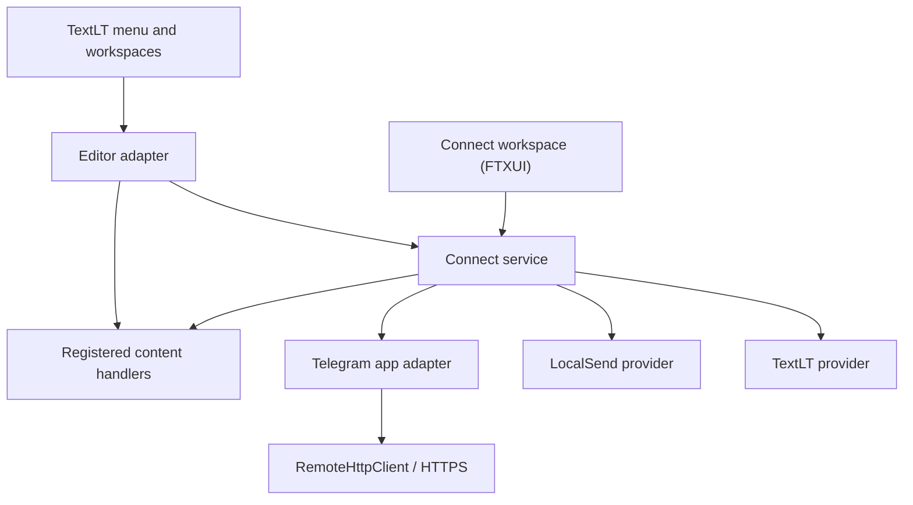

# TextLT Connect Architecture

The standalone library, TextLT and LocalSend providers, and Connect editor
workspace are implemented. Telegram is an application-level provider adapter
using the same provider contract. Baseline: TextLT `main` at
[`d2b7763`](https://github.com/ihor-liutak2/textlt/commit/d2b77630b65920487709458bac27fd4ee402bb76).

## Component boundary

Connect lives in [`connect/`](../connect/README.md) at the repository root.
Its C++17 core builds as a separate CMake library. The editor-only FTXUI
workspace in `connect/ui/` consumes the public core interface. The root
editor target compiles the UI and links `textlt::connect`. The standalone
target links OpenSSL and uses the Boost.Beast and Asio headers. It builds
without FTXUI. The Telegram adapter in `src/telegram/` implements
`IConnectProvider` in the editor target and uses the existing `RemoteHttpClient`;
it does not add dependencies to the standalone library.

The editor wires the command registry, workspace selection, focus, modal
layers, and screen wake-up callback. `connect/ui/` owns provider registration,
the event queue, peer selection, offers, conversation history, and drafts.
Connect Settings stays in its existing modal; Telegram has a separate settings
modal and settings file. File picking and Downloads resolution enter through
host callbacks. Notes and Actions snapshot serialization and imports stay in
the editor adapter. The standalone provider sources remain within `connect/`;
Telegram uses the application HTTP adapter without adding FTXUI to the core.

## Editor workspace

**Options → Connect** selects the fourth workspace. Its contextual
**Connect** menu opens one **Connect Settings** modal on the selected
Connections, Network, Identity, or Diagnostics tab. LocalSend has its own tab
in the same modal. Closing the modal returns focus to Connect.

The workspace has three panels:

1. **Local Connections** contains the existing TextLT and LocalSend controls,
   provider status, online peers, and configured/discovered conversations.
2. **Messengers** contains Telegram Start/Stop and Settings controls and
   authorized Telegram chats. Additional messenger providers are not
   implemented here.
3. **Conversation** renders one selected peer's history, incoming-offer
   controls, and composer. It uses the same conversation map and transfer
   capabilities as before; file actions remain available only when the
   selected provider advertises file support.

At terminal widths of 96 cells or more, the panels use approximately
20% / 20% / 60% of the available width, with minimum panel widths. Below that,
the two navigation panels share a row above the full-width conversation; at
very narrow widths the navigation panels stack above it. Layout is recomputed
on render after terminal resize. Each navigation panel has its own focus target
and scroll state; the Messenger panel scrolls its authorized-chat list.
Tab/Shift+Tab crosses from local connections to Messengers and then to
conversation controls. Navigation titles remain outside their scrolling
content. The conversation heading, composer, and active transfer controls
likewise remain outside the scrollable message history.

Conversation messages, current drafts, and scroll positions remain
peer-specific and session-only. Selecting a different peer saves the current
draft to that peer and restores the selected peer's draft. Switching the
application workspace keeps the Connect component alive, so these values are
not discarded by workspace navigation. This layout change does not add durable
conversation storage.

The left panel retains independent **Start** and **Stop** controls for TextLT
and LocalSend. Connect Settings saves configuration. The Messengers panel
owns Telegram's independent controls and settings modal. The native TextLT
listener defaults to TCP `53327`; LocalSend defaults to TCP and UDP `53317`.
TextLT generates a local identity on first use unless one is configured.
Pairing saves the peer ID and certificate fingerprint exchanged in the
pairing code. Notes and Actions use the same connection for snapshots. Workers
enqueue provider events and request an FTXUI wake-up. The editor drains the
queue on the UI thread, including while a different workspace is selected.
Stop joins the provider workers, and the editor also stops networking on exit.
Connect Settings persists edits separately from session-only UI state. The
editor detects and displays an active non-loopback IPv4 address for its
initial listener setting.

### Telegram Bot API

`TelegramProvider` in `src/telegram/` implements the existing
`IConnectProvider` contract with the stable provider ID `telegram`. The
standalone `textlt::connect` library and its TextLT/LocalSend transports are
unchanged. `TelegramHttpApi` uses the existing HTTPS `RemoteHttpClient` and
the official `getMe`, `getUpdates`, `sendMessage`, `sendDocument`, and
`getFile` Bot API methods.

One provider worker long-polls `getUpdates` for both chat discovery and
incoming messages. It advances and saves the Telegram `update_id` offset,
deduplicates replayed updates, and records discovered chats. Discovered chats
are not exposed as Connect peers until authorized. The provider checks the
authorized-chat list before transfers and discards incoming content from
other chats. Telegram advertises unversioned text and file capabilities.
`sendMessage` preserves UTF-8 and newline characters. For documents the
worker uploads with `sendDocument` and calls `getFile` after the user accepts
an incoming offer.

The worker handles Telegram `retry_after` responses and transient polling
errors with bounded exponential backoff when automatic reconnect is enabled.
Stopping the provider cancels its outstanding HTTP poll and joins the worker.
Outgoing sends are queued on that same worker; a confirmed rate-limit response
may be retried, while ambiguous send failures are not retried to avoid
duplicating messages.

Telegram settings are stored separately in `telegram-settings.json` beside the
main editor configuration (`$HOME/.config/textlt/telegram-settings.json` on
Linux, and `/state/.config/textlt/telegram-settings.json` in the current
Docker image). The token is protected by private POSIX file permissions but
is plaintext at rest; it is not written to application status or error
messages. See the [Telegram bot setup guide](telegram-bot-setup.md).

### Network diagnostics

The Diagnostics tab in `src/modals/` reads the address inventory from
`connect/ui/network_diagnostics.cpp`. Linux and macOS enumerate assigned
addresses with `getifaddrs()`. Native Windows uses
`GetAdaptersAddresses(AF_UNSPEC, ...)` and links the system IP Helper
library. Linux reads default routes from procfs. macOS uses the built-in
`/sbin/route` for IPv4 and IPv6 default routes. WSL uses Linux enumeration
for the guest and runs the built-in Windows PowerShell through interop.
It reads address and gateway fields as JSON from
`Get-NetIPConfiguration -All` and `Get-NetIPAddress`. The effective WSL
mode comes from `wslinfo --networking-mode` when available. PowerShell and
macOS route lookups run on a background worker. The editor build and
existing installer use these OS facilities without extra runtime packages.

The inventory drives both the IPv4 address list in Diagnostics and LocalSend Auto address
selection on Start. A manual selection must still be an eligible IPv4
address assigned to an interface visible to TextLT. Auto and manual modes
bind HTTPS to the selected address and use it as the multicast interface.
The UDP discovery socket binds the configured port and joins the configured
multicast group on that interface. Adapter and port details appear under
the Diagnostics **Info** button.

`LocalSendOptions` exposes optional runtime and verified-peer callbacks.
The provider reports actual socket state after Start or Stop, including
bind and multicast-join results on startup failure. Reachability uses
verified HTTPS traffic with a non-local address and excludes loopback and
the known local addresses. The editor requests a redraw when a provider
worker reports this evidence. The standalone library has no dependency on
the editor diagnostics code.

## First release

| Content | TextLT provider | LocalSend provider | Telegram provider | On receipt by TextLT |
| --- | --- | --- | --- | --- |
| Text | One-to-one chat between TextLT peers | One-off text transfer | Bot API message for an authorized chat | Show in the selected peer's conversation. For LocalSend, label it as a LocalSend transfer. |
| File | Direct transfer between TextLT peers | LocalSend file transfer | Bot API document for an authorized chat | Save a supported incoming file to Downloads after acceptance. |
| Note | Structured payload | Unsupported | Unsupported | Preview, then import a copy into Notes on request. |
| Action | Structured payload | Unsupported | Unsupported | Preview, then import a copy into the selected Actions page on request. |

Connect shows peers with their provider and enables the actions a selected peer
supports. It shows transfer progress and outcomes separately from import
outcomes. A LocalSend file remains an ordinary file regardless of its extension
or contents.

The design assumes recipients can accept or decline an incoming transfer. A
TextLT user can approve a peer for subsequent chat messages. Files and
structured items are presented as offers, and importing a note or action
requires another explicit choice after receipt.

## Public interfaces

Connect exposes the following contracts in `textlt::connect`.

| Interface | Responsibility |
| --- | --- |
| `ConnectService` | Own registered providers and handlers. Look up a provider by ID or resolve a structured handler by type ID and schema version. Peer state, operation routing, and event queueing are later service responsibilities. |
| `IConnectProvider` | Start and stop discovery and receiving, send payloads, accept or decline offers, cancel transfers, and report peers, offers, transfer outcomes, and received content via a callback. |
| `MakeTextLTProvider` | Create a text, file, and structured content provider with a local listen endpoint, a manually configured remote endpoint, or both. `TextLTProviderOptions` adds `listen_ip`, `peer_ip`, and optional `TextLTTlsOptions` for the certificate, key, and expected peer fingerprint. `TextLTDiscoveryOptions` enables discovery, and `trusted_discovery_peer_id` binds the configured pin to one discovery ID. |
| `MakeLocalSendProvider` | Create the LocalSend v2.2 HTTPS provider from the identity path, alias, IPv4 bind and multicast settings, ports, and deadlines. |
| Telegram application adapter | Implements `IConnectProvider` in `src/telegram/` and uses the existing `RemoteHttpClient` for the Bot API. It is outside the standalone Connect library and has no FTXUI dependency. |
| `TextLTCertificateFingerprint` | Read a PEM certificate and return its SHA-256 fingerprint for display or out-of-band verification. |
| `ContentHandler` | Declare a structured type and its supported schema versions. Validate a payload, supply a preview, and import it through a host callback. |
| Editor adapter | Supply domain payloads on send and turn incoming import requests into calls to the relevant TextLT workspace. Open the corresponding destination picker where needed. |

Providers and handlers register under stable string IDs. The editor adapter
registers `textlt`, `localsend`, and the application-layer `telegram` adapter.
The Telegram adapter advertises unversioned text and files. The workspace builds
operations from the selected peer's capabilities. For typed data, both ends
must support a common payload version. The LocalSend adapter supplies its text
and file capabilities from its own protocol rules.

Registration consumes the supplied provider or handler. IDs are nonempty
and case-sensitive, with separate namespaces for providers and handlers. Each
structured type has one handler that declares a nonempty list of distinct,
positive schema versions. The built-in text and file IDs are reserved.
Duplicate IDs return `DuplicateId` for otherwise valid registrations and
preserve the existing entry. Invalid definitions return `InvalidRegistration`.
Provider lookup returns a borrowed pointer or null. Handler lookup returns
`Found` and a borrowed handler, `UnknownType`, or `UnsupportedVersion`.
The host serializes registry access.

Provider callbacks can run concurrently on the discovery and transfer workers.
The editor workspace queues those events and consumes them on the UI thread.
The workspace calls provider operations through the registry. The host stops started providers before destroying the registry or
callback state. A provider operation's immediate result indicates request
acceptance. Transfer outcomes arrive separately via events.

### Data passed across the boundary

| Value | Fields and semantics |
| --- | --- |
| Peer identity | `provider_id` and provider-scoped `peer_id`. The peer record adds display name, online status, capabilities, and an optional protocol version. Addresses and authentication stay within the provider. |
| Capability | Type ID and the supported schema versions for structured types. Ordinary text and files have an empty version list. |
| Transfer identity | Peer identity and transfer ID. The ID identifies a transfer with that peer in a given direction. |
| Transfer metadata | Type ID, schema version for structured types, optional display name, and optional byte length. |
| Outgoing body | UTF-8 text, an owned binary input stream for a file, or opaque structured bytes. |
| Incoming offer | Transfer identity and metadata. To accept a TextLT file, the host supplies a `FileDestination` factory that stages data and commits it on the provider worker. |
| Provider event | Peer update, incoming offer, transfer state update, received text or structured bytes, or `IncomingConnectionFailure` for a TLS-mode connection that fails before a transfer identity is available. Transfer state updates include identity, direction, state, optional byte counts and reason, and an optional machine-readable failure code. File bytes go through the supplied stream. |

The TextLT wire format has a protocol version independent of each payload
schema version. The initial type IDs can be `connect.text`, `connect.file`,
`textlt.note`, and `textlt.action`. There is no closed enumeration of
structured types. IDs such as `textlt.project` or `textlt.calendar_event` are
examples for future registrations. The host can use the handler lookup
result to decline an offer with an unknown type or unsupported version.

## Provider behavior

### TextLT text protocol

Plain TCP is available for the existing development demo on `127.0.0.1`.
A non-loopback listener or destination requires TLS credentials and a
configured peer fingerprint. The provider binds to a specific numeric IPv4
address. The shared peer API uses the opaque ID `manual-peer` for the configured
manual destination. Authenticated incoming offers use the configured trusted
discovery ID when available, and otherwise use `manual-peer`. Plain loopback offers
carry ephemeral provider-scoped peer IDs. The provider advertises unversioned `connect.text` and, when TLS is configured, `connect.file`.

Connect links OpenSSL 3 through CMake's `OpenSSL::SSL` and
`OpenSSL::Crypto` targets. Public headers use standard C++ types. The TLS
transport requires TLS 1.3 with a certificate from each device. Each side
checks the presented leaf certificate's validity dates and matches its
SHA-256 fingerprint to the expected fingerprint verified out of band. The
handshake verifies possession of each certificate's private key. The pin
is the trust anchor. Tickets and session caching are disabled so each
connection repeats authentication. After verifying the client, the server
sends an encrypted byte `1` to release the client into the text protocol.
The client waits for that byte before sending the text protocol hello.

Each connection carries one transfer. The version 1 exchange, in byte order,
is as follows.

| Step | Sender | Receiver |
| --- | --- | --- |
| Negotiate | Send ASCII `TLTC` followed by the one-byte version `1`. | Reply with byte `1` for ready or `2` for unsupported version. |
| Offer | Send the one-byte transfer ID length, the four-byte unsigned big-endian body length, and the transfer ID bytes. | Publish `IncomingOffer`. Reply with byte `3` after `Accept` or byte `4` after `Decline`. A decline ends the exchange. |
| Deliver | After byte `3`, send exactly the advertised number of UTF-8 bytes. | Validate UTF-8, publish `ReceivedContent`, and then send byte `5` for receipt. Invalid UTF-8 gets byte `6`. |

A transfer ID has 1–64 ASCII bytes from `A–Z`, `a–z`, `0–9`, hyphen,
and underscore. The body can contain 0–65,536 bytes. The protocol version is
independent of payload schema versions. Endpoints close their connection after
the exchange.

The sender reports `Completed` only after consuming the receipt byte. A
decline reports `Declined`. Expired deadlines, failed connections or early
closes, and version rejection report `Failed` with distinct
`TransferFailure` codes. Invalid protocol data also has its own code. The
receiver can report a transfer outcome once it has a valid offer identity.
A certificate mismatch, missing certificate, or rejected certificate is
reported as `PeerAuthenticationFailed`. Other TLS errors have a separate
`TlsFailure` code. Before a transfer identity is available, a TLS-mode
listener reports the failure through `IncomingConnectionFailure`.
If the connection is lost after the receiver publishes the content, the sender
can still report a failure due to a missing receipt.

The provider handles one active transfer at a time. By default it allows five
seconds per side for the entire exchange, including the offer decision. The
timeout can be configured from 1 millisecond to 1 hour. Event callbacks run
on provider worker threads and must be thread-safe, return promptly, and avoid throwing. They can
accept or decline an offer immediately, or the host can decide later within
the deadline. Call `Start` and `Stop` from the owner thread. `Stop` cancels
pending work, joins both workers, and closes the TCP and discovery sockets
before returning.

The [loopback demonstration](../connect/README.md#loopback-demonstration)
runs a sender and receiver in separate processes. The
[two-device setup](../connect/README.md#trusted-text-between-two-devices)
uses the same demo with mutual TLS and manually configured IP addresses.

### TextLT file protocol

Text still uses the unchanged version 1 handshake and framing. A file
connection uses mutual TLS and negotiates version 2. After `Ready`, the
sender sends a one-byte command. Command `0` probes for file capability and
ends the exchange. Command `1` offers a file. The offer contains a one-byte
transfer ID length, a one-byte UTF-8 filename length, an eight-byte unsigned
big-endian file size, the transfer ID, and the filename. The same ID rules
apply as for text. The name is 1–255 bytes. Plain TCP accepts version 1 only.

After `Accept`, the sender streams exactly the declared byte count in
bounded chunks and sends an end marker (byte `8`). The receiver checks the
count and marker before committing the staged file. The sender additionally
checks its source for premature EOF and extra bytes before sending the marker.
The receiver sends the usual receipt (byte `5`) after publishing the file,
or byte `7` for a destination failure if the connection is still writable.
Progress events carry transferred and total byte counts. Successful chunk
I/O refreshes the streaming deadline. Cancellation closes the socket, and the
destination removes any uncommitted staging data.

For a manual endpoint, the editor opts in to a TLS capability probe. A
version 1 peer remains eligible for text. For discovery, the existing version
1 `TLTD` announcement is retained for older peers. A companion `TLTF`
announcement uses the same layout with text/file protocol version `2`.
New peers merge both announcements for the same endpoint and expire the file
capability separately. As with the original announcement, mutual TLS still
verifies the configured certificate before accepting any transfer.

### TextLT structured content

Ordinary text uses protocol 1 and ordinary files use protocol 2. Structured
snapshots use authenticated TLS protocol 3 with a one-byte command. Command
`0` returns a capability list. It starts with a one-byte count, followed by
each type ID length, schema version count, type ID, and unsigned 32-bit
big-endian schema versions. Both counts and ID lengths are one byte.
Text and file capabilities have empty schema lists. The editor registers
independent `ContentHandler` implementations for `textlt.note` and
`textlt.action` and supplies their capabilities and validation to the
provider. Configured manual and discovered peers are probed over TLS.
Earlier protocol versions retain their text and file behavior.

Command `1` offers structured data. The offer consists of one byte each
for the transfer ID, type ID, and display name lengths, a 32-bit unsigned
schema version, a 32-bit unsigned payload length, and the three strings in
that order. Integers are big-endian. The payload limit is 1 MiB. The receiver
rejects an unregistered type (reply `9`) or unsupported schema version
(reply `10`) before showing an offer. Acceptance lets the sender transmit
the declared body. The handler validates it before the receiver publishes
it to the conversation or sends the normal receipt. Reply `11` reports a
validation failure. The provider treats the body as opaque bytes.

Both editor schemas use UTF-8 JSON with the schema version carried in transfer
metadata.

| Type and version | Payload and validation |
| --- | --- |
| `textlt.note` 1 | Object with a string `title` and a nonempty `blocks` array. Each block has a `type` of `paragraph`, `bullet_item`, `numbered_item`, or `check_item`, an integer `indent` from 0–6, an integer `heading` from 0–3, a boolean `checked`, and a `runs` array of strings. A nonzero heading requires a paragraph. |
| `textlt.action` 1 | Object with a nonempty string `title` and a `tabs` array of one to four objects. Each tab has string `caption` and `content` fields and a boolean `hide_text`. Captions use the Actions workspace's 12-character limit. |

The conversation owns the received snapshot and its import state. After
preview, a separate confirmation imports into a local Notes group or
Actions page. Existing editor import APIs allocate fresh item IDs and the
Notes handler generates fresh block IDs. The conversation records a successful
import against the received peer and transfer ID and disables repeated import.
Transfer history and the import marker are scoped to the current editor
session. Source workspace IDs, local paths, timestamps, and provenance
are outside the wire schemas.

### TextLT LAN discovery

Discovery uses the existing platform sockets and adds no dependency. It joins
IPv4 multicast group `239.255.76.84` on UDP port `47653` through one
user-selected interface. Announcements use TTL 1. A browser can listen
without TLS credentials. A provider advertises once per second only when
discovery is enabled and its TLS listener is bound to the same interface.
Stopping the provider closes the UDP socket and drops group membership.

A version 1 datagram consists of ASCII `TLTD`, a one-byte discovery version
(`1`), a one-byte text protocol version, a two-byte big-endian TCP listen
port, one byte each for the peer ID and display name lengths, then those
strings. The provider uses the datagram's source address and the advertised
TCP port as the internal endpoint. The peer ID uses 1–64 ASCII letters,
digits, hyphens, or underscores, with `manual-peer` reserved. The display
name uses 1–96 UTF-8 bytes without ASCII control characters. A device uses
the same unique peer ID across restarts.

The provider ignores announcements carrying its own ID and malformed or
unsupported discovery datagrams. It tracks up to 128 peer IDs. Identical
announcements refresh presence without emitting another event. A change
in endpoint, name, or text protocol version emits a peer update. Five
seconds after the last announcement, the entry expires and emits an offline
`Peer` event. Addresses and ports stay inside the provider.

Announcements are unauthenticated endpoint hints. They do not carry
fingerprints or change trust settings. To send by a discovered peer ID,
the host configures that ID in `trusted_discovery_peer_id` and supplies the
peer's independently verified fingerprint through the existing TLS
configuration. The provider selects a fresh endpoint advertising the
supported text protocol version, then verifies the configured pin through
mutual TLS. The receiver publishes no offer until both sides authenticate
and the sender submits the offer. The existing manual destination remains
available.

### Planned TextLT integration

1. TextLT discovers a peer and gets its available capabilities and protocol
   version. A manually entered address can support early development and
   networks where automatic discovery is unavailable. Discovery alone does
   not authorize delivery.
2. The sender selects text, a file, a note, or an action. The provider submits
   the metadata. For content that requires approval, the receiver accepts or
   declines the offer before transfer.
3. The receiver acknowledges successful receipt only after validating the
   message or completing the file write. A failed or cancelled transfer stays
   separate from a completed one. Retries of the same acknowledged transfer
   should not add a second chat entry or saved copy.
4. Connect shows text in the peer conversation and exposes **Import** for a
   supported structured item. The host reports the import outcome separately.

The provider's identity is distinct from a display name and from the device
identifier in the Notes repository. Future trust management can build on these authenticated connections.

### LocalSend v2.2

The adapter in `connect/src/providers/localsend/` uses IPv4 multicast and
Beast HTTP/1.1 over OpenSSL. It accepts compatible 2.x HTTPS peers and
implements the [LocalSend v2.2 protocol](https://github.com/localsend/protocol).
The UDP announcement carries the alias, version `2.2`, desktop device
type, certificate fingerprint, actual HTTPS port, HTTPS protocol,
`download: false`, and `announce: true`. Discovery uses the datagram source
IPv4 address. Announcements trigger an HTTPS registration request with a UDP
`announce: false` fallback. The provider deduplicates by fingerprint and
filters its own identity. **Connect by IP** uses HTTPS registration at the
specified IPv4 address and verifies the returned fingerprint against the
peer's TLS certificate. Transfer requests can arrive through a TCP forward,
so their source addresses have lower priority than multicast and verified
HTTPS routes. TCP receive binding is exclusive and reports bind
errors in the Connect workspace and Diagnostics.

The adapter persists a self-signed certificate and its key in a LocalSend-only
PEM. Fingerprints are uppercase hex SHA-256 of the DER certificate.
Outgoing connections verify the selected fingerprint before sending HTTP
content and provide a client certificate when requested. Incoming HTTPS
requests with a client certificate must claim that certificate's fingerprint.
For a discovery registration without a client certificate, the adapter verifies
the advertised HTTPS listener at the request's source IP before listing the peer.
An incoming sender without a certificate uses a per-session unverified peer
identity. Every incoming offer requires approval. Uploads and cancellation
are bound to the preparing IP address, certificate identity when present,
and session. Uploads must also present the accepted file ID and its token.

`prepare-upload` queues offers into the existing conversation. The provider
allows one incoming session and returns tokens only for accepted files.
`upload` streams into the shared Downloads destination, verifies the declared
length and any supplied SHA-256, and replies after publication. A checksum
mismatch returns HTTP 422. Inline text uses a single UTF-8 preview with a
`text/*` media type or legacy `text` type. Both the declared size and the
preview must fit within 16,384 bytes. Accepted inline
text returns 204 directly. A text attachment without preview uses
`upload`. The inline and certificate rules follow the official
[preview implementation](https://github.com/localsend/localsend/blob/44f48f1/app/lib/util/message_preview.dart),
[CLI sending implementation](https://github.com/localsend/localsend/blob/44f48f1/cli/src/app/sending.rs),
and [v2 server implementation](https://github.com/localsend/localsend/blob/44f48f1/packages/core/src/http/server/v2.rs).

The sender holds an offer on HTTP 401 and retries its preparation with the
user-supplied `pin` query parameter. HTTP 403 maps to a refusal during
preparation or authorization failure during upload. HTTP 409 indicates a
busy session and 429 indicates rate limiting. Cancellation closes the
pending preparation request, or calls `cancel` with the accepted session
ID. The TextLT defaults allow 5 seconds for connect and TLS, 120 seconds
for a decision, and 30 seconds of upload inactivity. Transport and
discovery workers feed the existing UI-thread event queue. The adapter
exposes text and file capabilities. Browser download and protocol v1/v3
remain outside this adapter.

### Incoming files

The editor resolves the receiver's Downloads path using the Windows Downloads
known folder, the Linux XDG user directory, or the home directory's
`Downloads` as the default. `connect/ui/download_destination.cpp` reduces the
wire name to a safe basename and creates a staging file within Downloads.
After verification, it closes the staged stream and publishes a hard link
at an unused name. The filesystem arbitrates collisions atomically. The
destination retries with numbered names and removes staging on completion,
cancellation, or failure. A filesystem without hard links reports a
destination failure. The receipt follows publication, so a lost receipt can
leave a complete file at the receiver while the sender reports a failure.

## Integration with the existing editor

| Area | Existing TextLT API | Connect integration |
| --- | --- | --- |
| Notes | [`NotesWorkspaceComponent::ImportNote`](../src/notes/notes_workspace_component.cpp) creates a note from a title and structured blocks. | The note handler validates title and blocks. The host imports a new local note and resolves the local Notes destination. |
| Actions | [`ActionsWorkspaceComponent::ImportActions`](../src/actions/actions_workspace_component.cpp) appends items to the selected page. [`ActionItem`](../src/actions/action_model.hpp) contains a title and tabs. | The action handler validates the title and tabs. The host confirms the destination page and imports a new item. Received actions are stored as data. |
| Projects | [`ProjectStore`](../src/project_store.hpp) contains local folder paths and remote connection IDs. | A future project handler can define a portable payload and map its references on import. |
| Remote Files | [`IRemoteProvider`](../src/remote/remote_provider.hpp) describes browsing and changing remote files. | Connect has its own provider contract for communicating with peers. |

Use explicit transfer schemas for notes and actions. Transfer the content
needed for a copy, such as a note's title and blocks or an action's title and
tabs. The receiving workspace assigns its own identifiers, timestamps, and
group or page membership. A sender's local file paths, project IDs, and
revision counters are outside these payloads.

## Extension points and implementation sequence

An additional structured type needs a stable ID, a versioned payload, and a
registered handler. The handler supplies validation, preview, and import
behavior. The TextLT provider advertises the registration to peers, and Connect
routes the payload through the same interface. Project and calendar exchange
are future work.

Live document editing will use a separate capability and session interface.
It will have its own document identity, change stream, and conflict policy.
The first release shares document files as ordinary transfers.

1. Add the standalone Connect target and its public contracts. Demonstrate
   registering two structured handlers through the same interface.
2. Implement TextLT text delivery over TCP loopback with explicit offer
   decisions and receipt acknowledgment.
3. Enable manually configured LAN peers with mutual TLS and certificate pins.
4. Discover TextLT endpoints with opt-in LAN multicast. Preserve pinned TLS.
5. Add the Connect workspace and settings for TextLT text messaging.
6. Transfer ordinary files through the Connect workspace and save accepted files to Downloads.
7. Share and import Notes and Actions snapshots through the editor adapter.
8. Add LocalSend v2.2 LAN discovery and ordinary text and file exchange.
